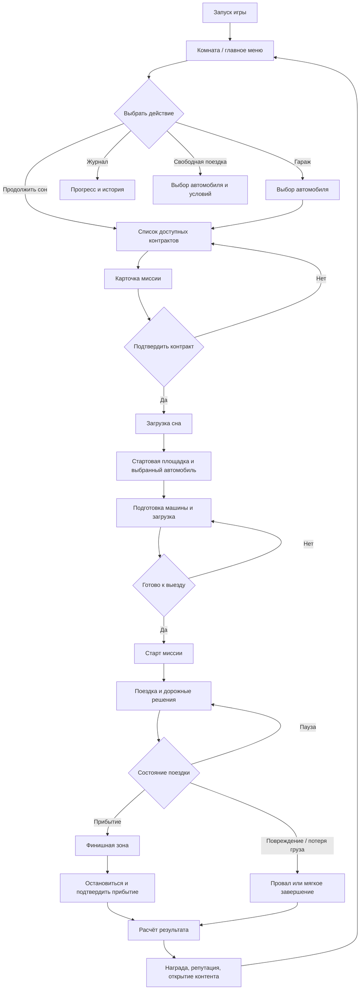

# Voyage Mirage — концепция игры и система миссий

> Рабочий дизайн-документ. Описывает не окончательный продакшен-план, а центральную игровую идею, вокруг которой можно собирать существующие системы.

## 1. Короткая формулировка

**Voyage Mirage** — производительная браузерная игра о дальних поездках на старых гражданских автомобилях. Игрок принимает работу, выбирает машину, готовит её к маршруту и старается доехать до цели вовремя, сохранив автомобиль, груз и комфорт пассажира.

Это не симулятор выживания и не набор разрозненных режимов. Это **карьера водителя**, представленная как серия снов мальчика, который мечтает научиться водить и стать человеком, которому можно доверить любую дорогу.

Главное обещание игроку:

> Мне доверили машину, груз и маршрут. Я сам решаю, как доехать, и постепенно становлюсь профессиональным водителем.

---

## 2. Что уже есть и что это даёт игре

У проекта уже есть необычно сильная основа:

- процедурная дорога, которую можно генерировать вперёд;
- широкий дорожный профиль с обочинами, съездами и участками с несколькими полосами;
- бесконечный процедурный ландшафт для ощущения настоящего пространства;
- трафик до нескольких десятков машин, умеющий распознавать препятствия, перестраиваться и обгонять;
- физика автомобилей и различия между моделями;
- машины с интерьером, открывающимися дверями, капотом и багажником;
- моторы, коробки передач, топливо, масло, охлаждающая жидкость, фильтры и расходники;
- пыль, грязь и изменение внешнего вида автомобиля;
- наклейки;
- прототип перевозки груза и соревнования доставщиков;
- LOD и отключение невидимой физики, необходимые для работы в браузере без WebGPU.

Проблема не в недостатке систем. Проблема в отсутствии общего ответа на вопрос:

> Зачем игроку начинать следующую поездку?

Решение — превратить бесконечную дорогу в последовательность **осмысленных отрезков-миссий**. Бесконечный мир остаётся технической и атмосферной основой, но игроку не нужно сразу объяснять его как бесконечную цель.

---

## 3. Основная структура: одна карьера, много контрактов

Не следует начинать с отдельных независимых режимов «гонка», «доставка», «спасение», «свободная езда». Это приведёт к нескольким маленьким играм, у каждой из которых будут свои цели и прогресс.

Рекомендуемая структура:

```text
Одна карьера водителя
    ├── обычные доставки
    ├── срочные рейсы
    ├── перевозка хрупких грузов
    ├── перегоны автомобилей
    ├── поездки с пассажиром
    ├── спасательные и медицинские контракты
    ├── точное вождение и парковка
    ├── испытательные маршруты
    └── свободные поездки без давления
```

Все задания используют один и тот же фундамент:

- автомобиль;
- дорога;
- трафик;
- физика;
- состояние машины;
- пункт назначения;
- оценка результата.

Различаются не базовые правила игры, а условия конкретной поездки.

---

## 4. Сны как сюжетная и структурная рамка

Мальчик засыпает и видит сны о вождении. Каждый сон — это серия связанных поездок. Такая рамка позволяет:

- свободно менять автомобиль, место, время суток и погоду;
- объяснять появление новых типов заданий;
- не строить сложный реалистичный сюжет;
- подавать игру небольшими главами;
- создавать ощущение постепенного взросления и роста мастерства.

Сны не должны превращать игру в набор несвязанных мини-игр. Внутри каждого сна игрок всё равно просто садится в машину и едет к цели.

### Пример последовательности снов

1. **Первая поездка** — короткий маршрут на простой машине.
2. **Нужный адрес** — первая доставка.
3. **Дальняя дорога** — большее расстояние и необходимость следить за топливом.
4. **До темноты** — таймер и вечерний свет.
5. **Хрупкий груз** — появляется комфорт и аккуратность вождения.
6. **Плохая погода** — сложнее видимость и сцепление.
7. **Срочный рейс** — ограниченное время и плотный трафик.
8. **Чужой автомобиль** — перегон машины с особым характером.
9. **Помощь на трассе** — спасательная или медицинская поездка.
10. **Большой маршрут** — финальная проверка навыков без необходимости вводить новый жанр.

Между снами достаточно коротких сцен в детской: новая игрушечная машина, рисунок дороги, наклейка, запись в журнале или открытая модель в гараже. Это эмоциональный контекст, а не отдельная игра про жизнь мальчика.

---

## 5. Игровой цикл одной миссии

Каждая миссия должна проходить через одинаковый понятный цикл.

### 5.1. Выбор контракта

Игрок видит несколько доступных предложений. Каждое имеет:

- тип поездки;
- расстояние;
- стартовую точку и пункт назначения;
- автомобиль или класс автомобилей;
- время суток;
- погоду;
- трафик;
- дедлайн;
- требования к грузу или пассажиру;
- базовую награду;
- возможные штрафы.

Не нужно показывать игроку всю техническую информацию. В интерфейсе достаточно человеческого описания:

> Доставить запасные детали на станцию за 42 км. Дорога сухая, движение плотное. Оплата выше обычной, но заказчик ждёт до заката.

### 5.2. Подготовка

Перед стартом игрок:

- выбирает автомобиль;
- осматривает его;
- проверяет топливо, масло и охлаждающую жидкость;
- при необходимости ремонтирует машину;
- кладёт груз в багажник;
- выбирает запасные расходники;
- при необходимости меняет наклейки или внешний вид.

Подготовка должна быть короткой и осмысленной. Это не ежедневная рутина выживания. Игрок должен думать: «Что понадобится именно для этой поездки?», а не заполнять множество обязательных шкал.

### 5.3. Старт на определённом участке

Миссия может перемещать игрока на заранее выбранный участок процедурной дороги. Это не противоречит бесконечному миру: генератор всё равно создаёт нужный участок, а миссия задаёт его параметры.

Для каждой миссии можно определить:

- длину дороги до цели;
- диапазон кривизны и перепадов высоты;
- наличие съездов и придорожных объектов;
- плотность трафика;
- время суток;
- погоду;
- приблизительные контрольные точки;
- набор машин, которые могут встретиться.

Игроку не нужно каждый раз ехать от одного глобального начала мира. Он сразу оказывается внутри конкретной поездки.

### 5.4. Движение и решения

По дороге игрок постоянно принимает естественные решения:

- обогнать или подождать;
- ехать быстро или беречь груз;
- тормозить заранее или рисковать;
- свернуть к заправке или продолжить путь;
- остановиться и проверить неисправность;
- выбрать короткий, но сложный съезд;
- продолжать поездку ночью или потерять время на остановку.

Эти решения должны возникать из дороги и физики, а не из искусственных диалоговых окон.

### 5.5. Прибытие и оценка

Миссия заканчивается, когда игрок достигает целевой зоны и корректно завершает поездку. После этого показываются:

- время прибытия;
- состояние автомобиля;
- состояние груза или комфорт пассажира;
- базовая награда;
- бонусы;
- штрафы;
- изменение репутации;
- открывшиеся контракты и автомобили.

После результата игрок возвращается к выбору следующей поездки, гаражу или следующему сну.

---

## 6. Таймеры, комфорт и состояние груза

### 6.1. Таймер

Таймер нужен не в каждой миссии. Он создаёт напряжение, но постоянный отсчёт сделает игру утомительной и лишит смысла спокойные поездки.

Рекомендуемые типы ограничений:

- **жёсткий дедлайн** — опоздание сильно снижает награду или проваливает контракт;
- **мягкий дедлайн** — игрок получает больше денег за раннее прибытие, но не теряет всё при опоздании;
- **время до события** — нужно успеть до заката, дождя или закрытия станции;
- **без таймера** — поездка на аккуратность, исследование или отдых.

Сначала лучше использовать мягкие дедлайны. Жёсткие ограничения должны появляться после того, как игрок научился управлять машиной и читать дорогу.

### 6.2. Комфорт пассажира

Комфорт — хороший показатель, но его лучше трактовать как показатель качества поездки, а не как ещё одну шкалу выживания.

На комфорт влияют:

- резкие торможения;
- столкновения;
- сильные заносы;
- чрезмерная скорость на плохом покрытии;
- повреждение машины;
- длительные остановки, если они запрещены условиями контракта.

Комфорт можно объединять с состоянием хрупкого груза в общий принцип: **поездка должна быть не только быстрой, но и аккуратной**.

Для пассажирской миссии результат может быть таким:

- пассажир доволен — полная награда и бонус репутации;
- пассажир терпел — частичная награда;
- поездка сорвана — штраф или провал.

Не нужны отдельные анимации пассажира или сложная система разговоров. Достаточно звуковых реакций, краткого текста после поездки и влияния на результат.

### 6.3. Состояние груза

Для груза можно использовать несколько простых категорий:

- обычный — важна только доставка;
- хрупкий — зависит от резких перегрузок и аварий;
- ценный — требует сохранности и даёт большую награду;
- срочный — важнее время;
- крупный — занимает место в багажнике и ограничивает выбор автомобиля.

Это позволит использовать физику и багажник, не создавая отдельную сложную логистическую игру.

---

## 7. Типы миссий

### Обычная доставка

Базовый и самый частый тип.

- положить посылку в багажник;
- проехать заданное расстояние;
- приехать в целевую зону;
- получить оплату.

Это основа, через которую игрок знакомится со всеми системами.

### Срочная доставка

- короткий или средний маршрут;
- мягкий или жёсткий таймер;
- плотный трафик;
- высокая награда;
- соблазн рискованных обгонов.

### Хрупкий груз

- комфорт и плавность становятся важнее максимальной скорости;
- резкие манёвры снижают качество доставки;
- хорошая поездка может быть выгоднее рискованной.

### Перегон автомобиля

Игрок получает чужую машину и должен доставить её до точки.

- нельзя сильно повредить автомобиль;
- характеристики машины меняют привычный стиль вождения;
- можно познакомить игрока с новым автомобилем до его покупки;
- техническое состояние становится частью задачи.

### Пассажирская поездка

- нужно доставить пассажира;
- важны время и комфорт;
- остановки и манёвры могут влиять на оценку;
- пассажир может быть просто условием контракта, без полноценного NPC.

### Спасательная или медицинская поездка

Игрок управляет специальным автомобилем, но остаётся именно водителем.

- нужно быстро добраться до точки;
- нельзя застрять или разбить машину;
- трафик создаёт напряжение;
- сама чрезвычайная ситуация может оставаться за пределами экрана.

Это позволяет получить драматичную миссию без сложной системы пожаров, толп людей, боя или gore-контента.

### Точный водитель

- приехать без столкновений;
- припарковаться в заданной зоне;
- сохранить автомобиль и груз;
- выполнить сложный манёвр.

Такой тип задания раскрывает габариты машин, обзор, зеркала, двери и медленное управление.

### Свободная поездка

- нет дедлайна;
- нет обязательного груза;
- можно ехать куда угодно;
- можно искать места, смотреть пейзаж и проверять автомобили.

Свободная поездка нужна для отдыха и атмосферы, но не должна заменять основной прогресс.

---

## 8. Пейсинг и чередование сложности

Кампанию нельзя строить как непрерывное повышение давления. После сложной миссии игроку нужен отдых, иначе дорога превратится в работу.

Пример ритма:

```text
простая доставка
→ дальний маршрут
→ спокойная свободная поездка
→ хрупкий груз
→ короткий отдых
→ срочная доставка
→ перегон новой машины
→ спокойная поездка ночью
→ спасательная миссия
→ большой финальный маршрут
```

Каждые несколько миссий игрок должен получать:

- короткий маршрут;
- отсутствие таймера;
- возможность выбрать автомобиль;
- красивое время суток;
- более высокую, но не опасную награду;
- возможность спокойно осмотреть машину и гараж.

Сложность можно повышать разными осями, а не только увеличением расстояния:

- больше трафика;
- сложнее погода;
- более узкая дорога;
- меньше времени;
- хрупкий груз;
- менее надёжный автомобиль;
- ночной маршрут;
- необходимость сохранять комфорт.

Не следует одновременно повышать все параметры. Каждая новая миссия должна вводить одну новую трудность или сочетать уже знакомые.

---

## 9. Прогрессия

### Репутация

Репутация открывает:

- более дальние маршруты;
- новые типы заказов;
- сложные погодные условия;
- ночные рейсы;
- дорогие автомобили;
- специальные контракты.

### Деньги

Деньги используются для:

- топлива;
- ремонта;
- расходников;
- улучшений;
- покупки автомобилей;
- косметики и наклеек.

Обслуживание должно быть важным, но не превращаться в наказание за каждую поездку.

### Автомобили

Новая машина не обязана быть просто быстрее предыдущей. У каждой должен быть характер:

- старый универсал — вместительный и практичный;
- маленький хэтчбек — экономичный и манёвренный;
- седан — устойчивый и удобный на трассе;
- фургон — полезный для крупных грузов, но медленный;
- мощная старая машина — быстрая, но прожорливая и требовательная;
- внедорожник — уверенный на плохих съездах, но тяжёлый на асфальте.

Новые автомобили должны открывать новые способы прохождения, а не только увеличивать числовые показатели.

### Косметика и личная история

Наклейки, грязь, царапины, состояние кузова и предметы в автомобиле позволяют игроку создать машину, которая выглядит как результат его поездок.

Это особенно важно для игры о личном опыте вождения: автомобиль становится не просто инструментом, а спутником.

---

## 10. Что не следует делать в первой версии

### Не начинать с полноценного города

Город потребует:

- большого количества зданий;
- сложных перекрёстков;
- дополнительной навигации;
- более тяжёлого трафика;
- большего количества правил движения.

На первом этапе достаточно придорожных посёлков, мотелей, заправок, сервисов, развязок и небольших промышленных зон. Они создадут ощущение населённого мира без дорогой городской симуляции.

### Не добавлять пеший режим

Если главная фантазия — управлять автомобилем, не нужно превращать игру в игру про хождение. Взаимодействия можно оставить внутри машины и на коротких остановках.

### Не добавлять survival-механику

Голод, жажда, сон, болезни, зомби и обязательные бытовые шкалы не нужны. Техническое состояние автомобиля уже даёт тематически подходящий риск.

### Не строить отдельный чемпионат гонок

Рейсы на время можно оставить как тип контракта. Полноценный гоночный режим будет поощрять агрессивное поведение и хуже использовать дальнюю дорогу, обслуживание, груз и трафик.

---

## 11. Производительность и масштаб

Ограничения WebGL в основном касаются:

- количества видимых объектов;
- draw calls;
- сложности освещения и материалов;
- количества одновременно симулируемых машин;
- памяти и потоковой генерации;
- скачков при компиляции шейдеров.

Они почти не ограничивают дизайн контрактов, наград, репутации и сценарных условий.

Для проекта выгодны:

- пустые пространства и дальние виды;
- небольшое количество крупных придорожных объектов;
- трафик вместо толп NPC;
- процедурная дорога;
- события, возникающие во время движения;
- атмосферный свет, звук и погода вместо дорогой геометрии;
- решения игрока вместо сложных кат-сцен.

Пустыня в таком проекте — не только способ сэкономить. Она подчёркивает расстояние, скорость, одиночество и важность дороги.

---

## 12. Рекомендуемый первый продукт

Первая полноценная версия может содержать:

- одну процедурную дорогу;
- несколько типов придорожных объектов;
- 4–6 автомобилей;
- трафик;
- топливо и базовое техническое состояние;
- гараж;
- контракты на доставку;
- деньги и репутацию;
- ремонт и простые улучшения;
- наклейки;
- свободную поездку;
- несколько времён суток и погодных условий.

### Пример первой миссии

1. Игрок выбирает старый автомобиль.
2. Получает посылку для придорожной станции.
3. Проверяет топливо и охлаждающую жидкость.
4. Загружает посылку в багажник.
5. Перемещается на подготовленный участок дороги.
6. Проезжает 10–15 км без жёсткого таймера.
7. Приезжает к станции.
8. Получает деньги и первую запись в репутации.
9. Открывает более дальний контракт и следующую машину.

После этого игра может постепенно вводить таймер, комфорт, трафик, погоду, ночные поездки и более требовательные автомобили.

---

## 13. Итоговое направление

**Voyage Mirage** не должна быть бесконечной поездкой без цели и не должна становиться набором мини-игр. Её основа — последовательность конкретных маршрутов, каждый из которых имеет начало, условия и пункт назначения.

Бесконечный мир остаётся за пределами миссии и поддерживает иммерсию. Миссия же даёт игроку структуру:

```text
Я знаю, куда еду.
Я понимаю, зачем еду.
Я выбираю, на чём и как ехать.
Я рискую ради времени, но отвечаю за машину и груз.
Я приезжаю и вижу последствия своего вождения.
```

Сравнение с первой **Mafia: The City of Lost Heaven** полезно именно на уровне структуры: большая игра подаётся как последовательность отдельных эпизодов с конкретной задачей и настроением. Но в Voyage Mirage эпизод заканчивается не выходом из машины и перестрелкой, а самой поездкой.

Игроку не обязательно спасать мир или переживать трагедию. Ему достаточно получить маршрут, повернуть ключ, услышать двигатель и подумать:

> «Ладно. Довезу». 

---

## 14. Вход в игру и flow миссии

### 14.1. Рекомендуемая модель: комната как главное меню

Лучше всего подходит гибрид обычного меню и небольшой интерактивной комнаты. Игрок не должен свободно ходить по полноценному дому: это добавит разработку, но не усилит основную фантазию. Вместо этого используется фиксированная или почти фиксированная камера с несколькими понятными интерактивными точками.

Комната даёт эмоциональный вход в сон, а обычные интерфейсные панели обеспечивают скорость и ясность.

Основные точки комнаты:

- кровать — начать или продолжить сон;
- стол с картой или записной книжкой — доступные контракты;
- гараж или ключи — выбор автомобиля;
- шкафчик с инструментами — подготовка и обслуживание;
- полка с игрушками, наклейками или фотографиями — прогресс и коллекция;
- окно — свободная поездка или короткий атмосферный переход.

Это даёт ощущение меню первой Mafia, где игрок перемещается между предметами, но не требует строить отдельный полноценный игровой уровень. На первом запуске можно показать короткую сцену: мальчик засыпает, камера переходит к игрушечной дороге, а затем к первому сну.

После первого прохождения меню не должно задерживать игрока. Кнопка «Продолжить» сразу открывает следующий доступный контракт, а комната остаётся местом, куда можно вернуться вручную.

### 14.2. Что игрок должен знать перед стартом

Перед миссией игроку нужны только решения, влияющие на поездку:

- куда ехать;
- сколько примерно ехать;
- что перевозится;
- есть ли дедлайн;
- насколько важны скорость, сохранность или комфорт;
- какую награду можно получить;
- какие автомобили подходят.

Не нужно показывать формулы расхода топлива, коэффициенты сцепления и скрытые технические значения. Важные ограничения должны быть сформулированы человеческим языком.

Пример карточки:

> Доставить медикаменты на станцию за 38 км. Нужно успеть до заката. Груз не любит резких ударов. Подойдут седан или универсал. Оплата высокая.

В первой миссии игрок узнаёт только четыре правила:

1. нужно доехать до отмеченной точки;
2. время и состояние груза могут влиять на награду;
3. автомобиль нужно подготовить;
4. результат поездки открывает дальнейший прогресс.

Остальные системы вводятся тогда, когда впервые становятся необходимыми.

### 14.3. Выбор автомобиля

Рекомендуется выбирать автомобиль **до загрузки сна**, в гараже или на экране контракта. Внутри самого сна уже должен находиться выбранный автомобиль, а не несколько одинаковых машин, ожидающих выбора.

Причины:

- игрок понимает, на чём он будет ехать, ещё до подготовки;
- не нужно создавать и обслуживать несколько полноценных автомобилей в стартовой сцене;
- проще сохранять состояние машин между миссиями;
- гараж становится частью прогрессии;
- физические взаимодействия с выбранной машиной можно показать уже после перехода в сон.

Правило выбора:

- в свободных и обычных миссиях разрешены все совместимые автомобили;
- для специального груза или роли можно ограничить класс машин;
- в сюжетной миссии можно выдать конкретный автомобиль;
- несовместимый автомобиль лучше не скрывать, а показывать как недоступный с понятной причиной.

Например: «Багажник слишком мал для этого груза» или «Для этой миссии нужен автомобиль с проблесковым маяком».

Игрок должен видеть не только лучший выбор, но и компромиссы:

- этот автомобиль быстрый, но расходует много топлива;
- этот вместительный, но медленно разгоняется;
- этот уже повреждён;
- этот экономичный, но хуже держит дорогу.

### 14.4. Где происходит подготовка

Подготовка должна происходить уже **в загруженном сне**, рядом с выбранным автомобилем. Меню отвечает за выбор и информацию, а сон — за физическое действие.

Так сохраняется важная фантазия:

> Я не нажал кнопку «готово». Я сам открыл капот, проверил машину, заправил её и положил груз в багажник.

Начальное состояние сна:

- выбранная машина стоит во дворе, у гаража или на стартовой площадке;
- её состояние перенесено из сохранения;
- рядом доступны топливо, жидкости, инструменты и груз;
- маршрутная карточка остаётся видимой как короткий список задач.

Минимальный обязательный чеклист:

- загрузить груз или посадить пассажира;
- убедиться, что топлива достаточно для базового маршрута;
- закрыть багажник, двери и капот;
- сесть за руль и начать поездку.

Дополнительные действия:

- долить масло;
- долить охлаждающую жидкость;
- заправить бак с запасом;
- заменить расходник;
- проверить повреждения;
- положить в багажник канистру или инструмент.

Подготовка не должна блокировать каждую миссию десятью обязательными действиями. В начале достаточно одного-двух ручных действий; новые проверки появляются постепенно. Для уже пройденных миссий можно дать быстрый вариант «подготовить автоматически», но ручная подготовка остаётся основным способом для игрока, которому важна материальность автомобиля.

### 14.5. Полный flow миссии



### 14.6. Шаги flow подробно

#### Шаг 1. Комната

Игрок видит состояние своей карьеры, доступные сны и выбранный автомобиль. Кнопка «Продолжить» ведёт к следующему незавершённому контракту. Никаких обязательных длинных сцен между миссиями.

#### Шаг 2. Выбор контракта

В начале главы контракты могут быть линейными. Позже игрок получает два или три предложения с разным соотношением риска и награды.

На карточке показываются:

- название и короткое описание;
- расстояние;
- ожидаемая длительность;
- время суток и погода;
- дедлайн;
- тип груза или пассажира;
- требования к машине;
- базовая награда и возможный бонус.

#### Шаг 3. Выбор автомобиля

Игрок выбирает машину из доступных совместимых автомобилей. Для первой сюжетной миссии выбор может быть заранее задан, чтобы не перегружать обучение.

Если выбран автомобиль с недостатком, игра не должна молча запрещать выбор. Она должна объяснить риск и дать принять решение, если это не нарушает физическую невозможность миссии.

#### Шаг 4. Загрузка сна

Генератор получает параметры миссии и создаёт нужный участок:

- стартовую площадку;
- маршрут заданной длины;
- целевую точку;
- дорожный профиль;
- трафик;
- время суток;
- погоду;
- придорожные объекты и возможные остановки.

Игрок перемещается не в абстрактное меню, а в конкретную сцену сна.

#### Шаг 5. Подготовка

Игрок видит автомобиль в физическом мире. Задачи отображаются коротким чеклистом. После загрузки груза и минимальной проверки можно сразу выехать.

Важно разделить:

- **подготовку**, которая задаёт состояние машины перед поездкой;
- **саму поездку**, где игрок принимает решения;
- **сервисные остановки**, которые могут появиться по ходу маршрута.

Не нужно заставлять игрока возвращаться в меню, чтобы купить бензин: если на маршруте есть заправка, он может воспользоваться ею физически.

#### Шаг 6. Старт

Миссия начинается, когда игрок выезжает из стартовой зоны. До этого можно спокойно закрыть двери, настроить приборы и осмотреть машину без работающего таймера.

После старта HUD показывает только необходимое:

- расстояние до цели;
- оставшееся время, если есть дедлайн;
- состояние груза или комфорт;
- предупреждение о критических неисправностях.

#### Шаг 7. Поездка

Маршрут может иметь промежуточные контрольные точки, но игрок не обязан останавливаться на каждой из них. Контрольные точки нужны для определения прогресса, событий и корректного завершения дальнего задания.

На дороге могут встречаться:

- медленный трафик;
- обгоняющие машины;
- заправки;
- сервисные площадки;
- съезды;
- погодные изменения;
- места для отдыха;
- необязательные объекты и короткие отклонения.

Основная миссия не должна проваливаться из-за одного пропущенного съезда. Если маршрут задаётся расстоянием, достаточно направить игрока к следующему участку дороги и целевой зоне.

#### Шаг 8. Финиш

Приезд должен быть физическим действием, а не пересечением невидимой линии. Игрок входит в целевую зону, снижает скорость и останавливается.

Для обычной доставки:

- автомобиль находится в зоне;
- скорость ниже порога;
- груз не уничтожен;
- игрок подтверждает выгрузку или ждёт короткую анимацию завершения.

Для парковочной миссии дополнительно проверяются положение и ориентация автомобиля. Для срочной доставки можно разрешить завершение без идеальной парковки, чтобы не разрушать темп.

#### Шаг 9. Расчёт результата

Система фиксирует состояние поездки сразу после прибытия:

- время;
- повреждения;
- состояние груза;
- комфорт пассажира;
- расход топлива;
- соблюдение особых условий;
- бонусы и штрафы.

Результат должен объяснять последствия, а не просто выдавать число:

> Доставлено вовремя. Груз сохранён. Два резких торможения снизили комфорт. Автомобиль получил небольшое повреждение.

#### Шаг 10. Возврат

По умолчанию игрок возвращается в комнату. Там он может:

- выбрать следующий контракт;
- осмотреть и обслужить машину;
- поменять автомобиль;
- открыть журнал;
- начать свободную поездку.

Для последовательной сюжетной главы после результата можно показать крупную кнопку «Следующий сон». Она не должна запускать новую миссию автоматически без подтверждения. Игроку нужно дать почувствовать завершение поездки и сохранить контроль.

### 14.7. Провал, повреждение и повтор

Большинство ошибок лучше делать мягкими:

- опоздание снижает награду;
- повреждение машины увеличивает стоимость ремонта;
- плохой комфорт уменьшает бонус;
- частично испорченный груз даёт неполную оплату.

Жёсткий провал нужен только для действительно невозможного результата:

- машина полностью обездвижена;
- груз уничтожен;
- игрок покинул допустимую область и не может вернуться.

После провала игрок возвращается не в начало всей главы, а к подготовке этой миссии. Машина и расходники должны восстанавливаться по состоянию сохранения перед стартом попытки либо требовать понятной оплаты ремонта. Главное — не заставлять повторять длинную предмиссионную сцену без необходимости.

### 14.8. Рекомендуемое решение

Итоговая схема:

```text
Комната
→ контракт
→ автомобиль
→ загрузка сна
→ физическая подготовка машины
→ поездка
→ прибытие и остановка
→ расчёт результата
→ комната
```

Меню отвечает за **выбор и понимание**. Сон отвечает за **подготовку и переживание поездки**. Дорога отвечает за **решения и напряжение**. Финиш отвечает за **последствия**.

Это разделение сохраняет сильные стороны проекта и не заставляет игрока выбирать между сухим интерфейсом и неудобным полноценным хождением по дому.

---

## 15. Миссионный коридор, старт и границы сна

### 15.1. Главный принцип

Миссия не заменяет существующий бесконечный мир. Она задаёт поверх него временный **миссионный коридор**:

- точку старта `A`;
- точку назначения `B`;
- допустимый участок дороги между ними;
- разрешённые зоны остановки и съезды;
- границы, за которыми сон начинает распадаться.

После завершения миссии эти ограничения исчезают. Свободная езда продолжает использовать текущий бесконечный режим без цели и без пробуждения за пределами маршрута.

### 15.2. Где спавнить игрока

Игрок должен появляться не на случайной точке асфальта, а в **стартовом POI**, расположенном рядом с дорогой:

- заправка;
- сервисная площадка;
- мотель;
- стоянка;
- придорожный двор;
- небольшая станция;
- временная площадка для специальной миссии.

Стартовый POI является частью сна и одновременно объясняет, почему автомобиль уже подготовлен к поездке. Машина стоит в зоне, где можно открыть двери, капот и багажник, загрузить груз и спокойно выехать.

Стартовый POI должен иметь:

- безопасное место для спавна;
- подъезд к дороге;
- понятное направление выезда;
- визуальный ориентир;
- возможность подготовить машину;
- небольшую зону, в которой таймер ещё не идёт.

Точку `A` лучше считать не самим местом появления автомобиля, а **началом маршрута** на дороге. Игрок может сначала выехать со стоянки, развернуться внутри площадки и только затем пересечь стартовый маркер.

### 15.3. Направление поездки

При загрузке миссии автомобиль ставится в правильной ориентации, а дорожные столбы находятся справа от дороги. Это даёт естественное физическое объяснение направления.

Однако одних столбов недостаточно. В начале задания нужны три уровня подсказки:

1. физический указатель у стартового POI;
2. видимый дорожный знак или табличка с названием цели;
3. маленькая ненавязчивая подсказка в интерфейсе: «Цель впереди — 38 км».

Не следует постоянно рисовать крупную стрелку перед автомобилем. Игрок должен чувствовать, что едет по настоящей дороге, а не по коридору с навигатором. Для первой миссии подсказка может быть более заметной, затем постепенно исчезать.

Если игрок развернулся, дорожные столбы окажутся слева, трафик будет идти навстречу, а расстояние до цели начнёт увеличиваться. Это уже достаточно ясно сообщает, что выбранное направление неверно.

### 15.4. Координата маршрута

Для миссии нужен не только номер POI, но и продольная координата на дороге:

```text
startDistance = 0
finishDistance = missionLength
```

Миссия может задать длину маршрута произвольно, например:

- 2.5 км для обучения;
- 12 км для обычной доставки;
- 38 км для среднего рейса;
- 80 км для большого маршрута.

POI используются как визуальные и функциональные якоря, но не должны ограничивать длину миссии сеткой «объект раз в N километров». Если готового POI нет, генератор может создать лёгкий mission endpoint: дорожный знак, стоянку, ворота, сервисную площадку или другую целевую декорацию.

Положение игрока оценивается относительно продольной координаты маршрута:

- движение к `finishDistance` увеличивает прогресс;
- разворот уменьшает прогресс;
- движение назад между `A` и `B` разрешено;
- достижение `B` переводит миссию в состояние прибытия;
- выезд за допустимый запас до `A` или после `B` активирует границу сна.

Это позволяет игроку передумать, пропустить съезд или вернуться к предыдущей точке, не проваливая миссию мгновенно.

### 15.5. Что разрешено внутри миссионного коридора

Коридор не должен быть узкой невидимой линией по центру асфальта. Игроку нужно разрешить:

- ехать по своей полосе;
- перестраиваться;
- останавливаться на обочине;
- заезжать на широкую обочину;
- пользоваться заправками и сервисами;
- заезжать в стартовые, финишные и боковые POI;
- ненадолго съезжать на грунт рядом с дорогой.

Поэтому граница считается не от центральной линии дороги, а от расширенного маршрута. У каждого POI есть собственная разрешённая зона, соединённая с коридором.

### 15.6. Разворот и движение назад

Разворот между `A` и `B` не является ошибкой. Игрок может:

- проехать нужный съезд;
- вернуться за пропущенным объектом;
- проверить состояние машины;
- развернуться из-за дорожной ситуации;
- просто исследовать уже пройденный участок.

В этот момент нужно только менять состояние подсказки:

- «Вы возвращаетесь к началу»;
- «Цель удаляется»;
- «До маршрута осталось 4 км».

Не следует телепортировать машину, отменять миссию или резко затемнять экран только из-за движения в обратную сторону.

Если игрок проехал финишный POI, но не остановился, миссия не должна автоматически считаться проваленной. Целевая зона остаётся доступной для возвращения. За ней есть небольшой запас дороги, после которого начинается предупреждение выхода за пределы.

### 15.7. Выезд в пустыню

Поскольку основной мир бесконечен, миссионная граница должна быть мягкой и тематической. Это не невидимая стена и не внезапный телепорт.

Рекомендуется три стадии.

#### Стадия 1: свобода

Игрок находится на дороге, в обочине, в разрешённой зоне POI или недалеко от маршрута. Никакого эффекта нет.

#### Стадия 2: предупреждение

Игрок достаточно далеко от коридора или пересёк внешнюю границу до старта. Появляются:

- слабое затемнение по краям экрана;
- лёгкое расплывание горизонта;
- приглушение звука;
- короткая фраза «Вы удаляетесь от сна»;
- небольшой обратный отсчёт или шкала пробуждения.

Игрок может спокойно вернуться. Если он вернулся в коридор, эффект полностью исчезает.

#### Стадия 3: пробуждение

Если игрок продолжает удаляться за пределы, сон постепенно распадается:

- изображение становится светлее или мягче, а не резко темнее;
- звук дороги уходит в низкочастотный гул;
- интерфейс показывает «Сон заканчивается»;
- камера делает короткий fade;
- игрок возвращается в комнату.

Лучше использовать уже существующие в игре эффекты затемнения, тумана, виньетки или расфокусировки, а не строить отдельную сложную систему распада мира.

### 15.8. Что происходит после пробуждения

Досрочное пробуждение означает **миссия прервана**, но не обязательно катастрофический провал.

В комнате игрок видит:

> Сон оборвался. Поездка не завершена.

Доступны действия:

- повторить миссию;
- вернуться к выбору контрактов;
- открыть свободную езду.

Для первой версии безопаснее делать снимок состояния в момент начала сна. При досрочном пробуждении можно вернуть автомобиль, топливо и груз к состоянию перед попыткой. Это не наказывает игрока за случайный съезд в пустыню и делает границу понятной, но не раздражающей.

Если игрок уже доехал до финиша и получил результат, состояние поездки фиксируется обычным образом. После этого начинается отдельная сцена возвращения, а не пограничное пробуждение.

### 15.9. Настройки конкретной миссии

Каждая миссия должна описываться данными, а не отдельным кодом:

- детерминированный seed;
- тип и визуальный образ стартового POI;
- тип и визуальный образ финишного POI;
- длина маршрута;
- форма и сложность дороги;
- время суток;
- погода;
- плотность и состав трафика;
- доступные съезды и остановки;
- число и тип миражей;
- требования к автомобилю;
- груз или пассажир;
- дедлайн;
- условия комфорта;
- награда и штрафы;
- запас за стартовой и финишной границами;
- разрешённые зоны вне основной дороги.

Количество миражей должно задаваться миссией и использовать детерминированный seed. Тогда миражи можно сочетать с настроением главы:

- в первой миссии их нет;
- в спокойной поездке их мало;
- в пустынном ночном сне они чаще встречаются на горизонте;
- в специальной миссии они могут быть привязаны к конкретным участкам.

### 15.10. Свободная езда

Текущий бесконечный режим нужно сохранить как отдельный пункт комнаты:

```text
Комната → Свободная езда → текущий игровой мир
```

В свободной езде:

- нет `startDistance` и `finishDistance`;
- нет миссионного коридора;
- нет пробуждения за пределами дороги;
- игрок может ехать в любую сторону;
- процедурный ландшафт остаётся бесконечным;
- цель — самому определить, насколько далеко получится уехать.

Миссии должны быть оболочкой над существующим миром, а не заменой его. Разница между режимами — в наличии контракта и ограничений:

```text
Миссия: существующий мир + старт + цель + коридор + оценка
Свободная езда: существующий мир без цели и границ сна
```

Это позволяет сохранить нынешнюю игру как самостоятельный режим и не уничтожает её ценность после появления сюжетной карьеры.

### 15.11. Рекомендуемый первый сценарий

Первая миссия должна использовать самый ясный вариант:

1. игрок выбирает «Продолжить сон»;
2. появляется карточка: доставить посылку на станцию за 8 км;
3. загружается маленькая стартовая стоянка;
4. рядом стоит одна доступная машина;
5. игрок кладёт посылку в багажник;
6. проверяет топливо;
7. видит знак с названием станции и направлением;
8. выезжает на дорогу;
9. проезжает маршрут без жёсткого таймера;
10. может остановиться на финише и выгрузить посылку;
11. получает результат;
12. возвращается в комнату.

После этого можно показать свободную езду как отдельный открывшийся пункт. Игрок сразу понимает разницу: сон имеет цель и границы, а свободная дорога не заканчивается.

### 15.12. Итоговое решение

Старт и финиш — это не просто километровые числа и не только POI. Это три связанных слоя:

1. **логический слой** — координаты `A`, `B`, длина и границы;
2. **физический слой** — стартовый и финишный POI, подъезды, стоянки и знаки;
3. **атмосферный слой** — направление, миражи, погода и эффект пробуждения.

Игроку разрешено ошибаться внутри маршрута. Он может развернуться, вернуться, остановиться и снова продолжить. Ограничение начинается только тогда, когда он явно покидает пространство сна или слишком далеко уезжает после финиша.

Так миссии остаются структурированными, но не ощущаются как закрытые трассы. А свободная езда сохраняет прежнюю фантазию — бесконечное путешествие без контракта и внешней цели.

---

## 16. Реализация: что сделано и что дальше

Миссии в коде называются **снами** (`src/dreams/`). Сон — это слой поверх существующего мира: дорога, пустыня, трафик и машины те же, что в свободной езде. Сон только читает положение игрока на дороге и решает два исхода: доехал или проснулся.

### 16.1. Шаг 1 — скелет сна ✅

Сделано:

- `src/dreams/dream.ts` — `DreamDef` (сид мира, км старта, длина маршрута, время суток, модель машины) и `DreamRun` — логика коридора без three.js и физики.
- `src/dreams/view.ts` — строка цели вверху экрана, эффект пробуждения (CSS blur и светлая пелена, без шейдеров), карточка итога с кнопкой «Wake up».
- Титульное меню: сны идут первыми, затем «Continue», «Free drive» (бывший «New drive») и «Settings».
- `main.ts`: сон создаёт мир по своему сиду, ставит машину на правую обочину на `startS`, а игрока рядом с ней. Внутри сна автосейв и сохранение при скрытии вкладки выключены.

Правила коридора (константы в `dream.ts`):

| Правило | Значение |
|---|---|
| Ширина коридора от оси дороги | 70 м в каждую сторону |
| Запас назад за стартом | 400 м |
| Запас вперёд за финишем | 600 м |
| Время до пробуждения вне коридора | 8 с, при возвращении эффект спадает в 3 раза быстрее |
| Финишная зона | ±25 м от точки B |
| Финиш засчитывается | игрок в машине, скорость < 1.5 м/с, 1.5 с подряд |
| Начало поездки | 30 м от старта |

Разворот внутри маршрута разрешён и ничего не ломает.

Проверено: логика — одноразовым скриптом (езда, разворот, уход в пустыню и возврат, финиш, выезд за старт и за финиш); игра — в браузере (старт на 12 км, пробуждение, возврат в меню, «stop here» в точке B, свободная езда без изменений). Прибытие в игре проверено dev-путём: посадка в машину из паузы («Drive nearest car») и перенос машины в ворота (`__bro.jumpTo`). Настоящий проезд 8 км за рулём ещё не сделан.

Известные ограничения шага 1:

- смена графики с перезагрузкой страницы (Very Low ↔ остальные) во время сна возвращает в свободную езду;
- кнопка «Save drive» в паузе внутри сна сохраняет поездку как обычную.

### 16.2. Шаг 2 — видимый старт и финиш ✅

- `src/dreams/markers.ts` — `DreamMarkers`.
- Старт: зелёный щит на правой обочине в 40 м впереди машины: название цели и расстояние («STATION / 8.0 km ahead»).
- Финиш: ворота над дорогой в точке B — две стойки за кромкой асфальта, перекладина и оранжевый щит «STATION / STOP HERE» на высоте 4.6 м (проходит любая машина).
- Название цели — поле `goalName` в `DreamDef`.
- Сделано из существующего кита вывесок (`signMaterial`, `box`), чьи программы прогревает при загрузке `marketProgramAnchor`; ориентиры добавляются в сцену до прогрева. Замер: 101 программа на старте и 101 у ворот — новых шейдеров во время езды нет.
- Каждый ориентир — отдельная группа относительно плавающего начала координат и сдвигается при каждом rebase.

### 16.3. Шаг 3 — посылка ✅

- Посылка — обычный `contract_cargo` вида `parcel`, поэтому багажник, руки, земля и меши предметов работают с ней как с посылкой курьера; её программы уже прогреты (`itemProgramAnchor`).
- `DreamDef.cargoName` (у первого сна — «medical parcel»; `null` — сон без груза). `dreamCargo()` в `dream.ts` собирает предмет с id `dream:cargo`.
- Посылка лежит на обочине в 4 м за багажником машины.
- `sourceCourierIndex = NO_COURIER` (`contracts/types.ts`): ни один курьер её не подпишет («this parcel goes to the gate at the end of the road»), и строка HUD не зовёт к курьеру.
- Сон засчитывается только если посылка на борту: в багажнике машины, за рулём которой игрок, или у него в руках, пока он в машине.
- Строка цели подсказывает: «Put the medical parcel in the boot — it is behind the car» до отъезда и «…is not in the car — it is back at the start», если уехал без неё.
- Уехать без посылки можно: сон не блокирует старт, а просто не засчитает финиш. Вернуться за ней можно в пределах коридора.

Проверено: правило груза — скриптом (у ворот без посылки сон продолжается, с посылкой — завершён, сон без груза — завершён). В браузере: посылка видна за машиной, у ворот без неё сон не завершается и строка напоминает о ней; с посылкой в багажнике — «delivered». В багажник посылка перекладывалась теми же изменениями состояния, что делает интерфейс багажника, но не руками через сам интерфейс.

### 16.4. Какие предметы могут быть грузом

Грузом может быть любой предмет, а не только коробка. В игре уже есть футбольный мяч, солнечные очки, лекарства, фотоаппарат, карманные часы, бинокль, фонарик. Сейчас сон везёт `contract_cargo`, потому что у него есть всё нужное для доставки: имя, состояние, учёт в багажнике и руках. Варианты на будущее:

- **Посылка-коробка** — как сейчас; имя на этикетке («medical parcel», «cassette parcel»).
- **Предмет без упаковки** — мяч, плюшевый мишка, фотоаппарат. Нужен признак «это груз сна» на любом предмете или новый вид `contract_cargo` со своей моделью. Плюшевого мишки в игре пока нет — это новая модель.
- **Хрупкий груз** — у `fragile_radio` уже есть состояние, которое падает от ударов: основа для оценки сохранности в шаге 4.

### 16.5. Груз в салоне

Сделано в шаге 8 (ниже). Пассажирские сны займут те же места: пассажир «занимает» сиденье так же, как вещь (`seatTaken`).

### 16.6. Отзыв после первого проезда и переработка старта и финиша

Владелец проехал первый сон. Решения:

1. **Старт с площадки (lay-by, `world/layby.ts`)** у придорожного POI, а не с обочины. **Парковочный карман — в глубине площадки, на месте машины квестодателя** (`laybyCourierLateral`): на площадках старта и финиша сна курьер не стоит. Карман обозначен **пунктирным прямоугольником** разметки и не мешает проезжающим машинам (их линия стоянки — `laybyParkLateral`, ближе к дороге). Вверенная машина стоит в кармане. Сон (таймер, расстояние, соперники, комфорт) **включается на выезде из кармана** — машина целиком пересекла его рамку.
2. **Финиш — такая же площадка с карманом** у POI в конце маршрута. Ворота над дорогой из шага 2 уходят.
3. **Терминал приёма и выдачи посылок** рядом с карманом — простая постройка с одним окошком (сетка из одной ячейки, как багажник курьера).
   - **Выдача:** посылку достают из окошка; экран терминала показывает **PIN из 6 цифр**. Вводить его при выдаче не нужно.
   - **Сдача:** чтобы положить посылку в окошко терминала на финише, нужно набрать этот PIN **на дисковом номеронабирателе** — маленькая мини-игра. Доставка засчитывается, когда посылка легла в окошко.
4. **Погода и время задаются сном.** Первый сон: 10:00, ясно, без дождя, бури и хабуба (`forceWeather` на всё время сна).
5. **Названия пунктов.** Генератор 200–300 читаемых названий из слогов. Каждая площадка POI получает название детерминированно от сида и `Poi.index`. На каждой площадке — указатель на ближайшие пункты назад и вперёд с расстоянием. На посылке видно название пункта назначения. Указатели появятся и в свободной езде.
6. **Без полиции в первом сне** — флаг сна выключает посты.
7. **Первый сон — на первых километрах** (обычный цвет песка); остальные сны — на площадках случайных километров.

**Шаг 3a сделан.** `DreamDef` получил поля `weather` (`WeatherKind`) и `police`. При старте сна `forceWeather(def.weather, 0)` держит погоду на всё время сна; `PolicePatrol.postsEnabled = def.police` выключает посты (ранний выход в `refreshPosts`). Первый сон: 10:00, `clear`, без полиции. Проверено в браузере: на 3–10,5 км часы идут от 10:02, погода `clear`, дождя и пыли нет. Посты: накопительный проход чтения постов по 2–40 км даёт 4 поста в свободной езде и 0 во сне.

**Шаг 3b сделан.**

- Площадки на сиде первого сна стоят только у придорожных POI, примерно раз в 7,7 км, и почти у всех есть курьер. Поэтому карман сна встаёт **на место курьера**, а на двух площадках сна курьер не появляется: `PoiProvider` получил `courierFreeStops` (`Poi.index`), их даёт `dreamStops(route)`.
- `DreamDef.startNearS` и `lengthM`: старт — первая площадка на `startNearS` или дальше, финиш — первая площадка не ближе `lengthM` от старта (`dreamRoute`). Обе стороны дороги разрешены; с левой площадки машина выезжает через встречную полосу. Площадка должна быть не уже 7,5 м, чтобы карман не задевал линию стоянки трафика.
- Первый сон: старт на 7,7 км (площадка слева), финиш на 15,4 км (справа), 7,7 км пути.
- Карман: 6,4 × 2,7 м, центр — `laybyCourierLateral`, машина вдоль дороги. Разметка — пунктирный прямоугольник (`src/dreams/markers.ts`): одна склеенная геометрия на карман, материал кита POI, программы уже прогреты. Замер: 101 программа до и после — новых шейдеров нет.
- **Чекпоинт:** сон начинается, когда игрок в машине и машина целиком вышла из рамки кармана (центр за рамкой, раздвинутой на половину длины и ширины легковушки — 2,4 и 0,95 м). Время поездки считается с этого момента.
- **Финиш:** центр машины внутри рамки финишного кармана, скорость < 1,5 м/с, 1,5 с подряд, посылка на борту.
- Строка цели: до старта — «drive out of the marked bay to set off»; ближе 13 м к финишу — «park in the marked bay»; ближе километра расстояние в метрах.
- Ворота и щит на старте убраны: указатели будут в 3d.

Проверено: правила кармана — скриптом (машина в кармане — не поехали; нос вышел — не поехали; целиком вышла — поехали; встала в 6 м за карманом — не финиш; в кармане — финиш). В браузере: машина стоит в кармане в глубине площадки старта с пунктирной разметкой, курьера нет; выезд из кармана переключает строку на расстояние до цели; машина, поставленная в финишный карман, завершает сон «7.7 km».

**Шаг 3c сделан.**

- `src/dreams/terminal.ts` — `ParcelTerminal`: шкаф с одним окошком и экраном, стоит на площадке в 0,7 м перед передним краем кармана, лицом к карману. Из кита POI (`box`) и вывески рынка — программы уже прогреты; новых шейдеров нет (101 → 101). Неподвижный коллайдер: машина, заезжающая носом, упирается в терминал. Сдвигается вместе с началом координат (меш и тело).
- **Стартовый терминал:** посылка лежит в окошке, на экране «PARCELS / PIN 221 685». [F] — посылка в руки (если руки свободны). PIN — 6 цифр из сида сна (`dreamPin`), одинаковый каждую ночь.
- **Финишный терминал** (экран «PARCELS / DROP-OFF»): [F] с посылкой в руках кладёт её в окошко — это и есть доставка. Пока машина не стоит в финишном кармане, терминал отвечает «Park the car in the marked bay first». С пустыми руками — «bring the medical parcel from the boot».
- Посылка больше не лежит на земле: она в окошке стартового терминала.
- `Interaction` получил узкий хук `InteractionFixture` (луч, подсказка, действие [F]): терминал — его реализация, сам `Interaction` о снах ничего не знает.
- `DreamRun`: финиш наступает не сам — `deliver()` проходит, только если машина сна стоит в финишном кармане (центр в рамке, скорость < 1,5 м/с). Чекпоинт и парковка считаются по позе самой машины (`DREAM_CAR_ID`), где бы ни стоял игрок. Место посылки — `CargoPlace`: `window` / `aboard` (багажник машины сна или руки) / `away`.
- Строка цели ведёт по шагам: «Take the medical parcel from the terminal in front of the car» → «Put the … in the boot» / «drive out of the marked bay to set off» → расстояние → «park in the marked bay» → «take the … to the terminal».
- Существующее правило игры работает само: с посылкой в руках в машину не сесть («stow the … in the boot first»), поэтому посылка едет в багажнике.

Проверено: логика сдачи и PIN — скриптом (до старта сдать нельзя; машина в 8 м за карманом — нельзя; машина в кармане — можно). В браузере: стартовый терминал виден, подсказка «[F] take the medical parcel — PIN 221685 on the screen», настоящая клавиша F кладёт посылку в руки, экран и подсказка продолжают показывать PIN. На финише: подсказки терминала с пустыми руками и с посылкой, F по финишному терминалу завершает сон «delivered». Перекладывание в багажник и обратно и выход из машины в проверке делались изменениями состояния, а не руками через интерфейс багажника и двери.

**Шаг 3c+ сделан.**

- `src/dreams/dial.ts` — `dialPin(root, pin)`: дисковый номеронабиратель поверх игры (SVG в DOM — ни шейдеров, ни текстур). Диск с десятью отверстиями над кольцом цифр, упор на «четырёх часах». Цифру набирают, вставив курсор в отверстие и протянув диск по часовой стрелке до упора; отпущенный диск возвращается сам. Недотянул (больше 7° до упора) — цифра не набрана.
- Неверная цифра сбрасывает номер («Wrong number — the line clicks dead»). Шесть верных — «The window unlocks», окошко открывается.
- Цифровые клавиши тоже набирают (диск проворачивается сам). Esc вешает трубку: диск закрывается, посылка остаётся в руках, игра продолжается.
- Финишный терминал: экран «PARCELS / DIAL YOUR PIN», подсказка «[F] dial the PIN to open the window». F открывает диск, игра на это время стоит (как в паузе, указатель мыши освобождён). После набора посылка ложится в окошко — это и есть доставка.
- PIN напечатан и на этикетке посылки («medical parcel · PIN 221685»), чтобы его не надо было запоминать со стартового экрана.

Проверено в браузере: на финише F открывает диск; протягивание мышью «2» на 60% пути не набирает цифру; «9» вместо «2» сбрасывает номер с сообщением; протягиванием 2-2-1-6-8-5 сон завершается «delivered». Повторный прогон: Esc закрывает диск, меню паузы не открывается, посылка в руках, игра идёт; набор с клавиатуры 221685 завершает сон. Ошибок нет.

**Шаг 3d сделан.**

- `src/world/placenames.ts`: 240 названий, написанных вручную, все разные. Раздача — `placeNameAt(seed, s)`: каждый сид один раз тасует список, площадка берёт название по номеру своего слота. Соседние площадки не повторяются, повтор — через 240 слотов (больше 1 800 км). Сохранения не меняются: название — функция сида и места.
- `src/world/signposts.ts`: `SignpostProvider` ставит на каждой площадке (во снах и в свободной езде) щит на двух столбах у дальнего края площадки, лицом к дороге. Сверху — название пункта, ниже — соседние площадки назад и вперёд со стрелками и расстоянием. Стрелки — как видит водитель с дороги: у площадки слева «вперёд» справа, у площадки справа — слева. Для первой площадки «назад» — «Home». Текстура у каждого щита своя (`paintSign`, вынесена из `signMaterial`) и освобождается вместе с чанком; программы — вывески рынка и кита, новых шейдеров нет. Коллайдеры на столбах.
- Сон: `DreamRoute.startName` / `goalName` из названий площадок; поле `DreamDef.goalName` убрано. Строка цели называет пункт (первый сон: из Hollow Spoon в Tinderly). Экран стартового терминала — «TO TINDERLY / PIN 221 685», подсказка — «[F] take the medical parcel for Tinderly — PIN …», этикетка посылки — «medical parcel for Tinderly · PIN 221685».

Проверено: 240 названий, 240 уникальных; тексты щитов на первых 40 км сида первого сна — стрелки и расстояния верны с обеих сторон дороги. В браузере: экран стартового терминала «TO TINDERLY»; в свободной езде на площадке стоит щит «DANDELION / ← Home · 7.7 km / Whistle Pan · 7.7 km →» (сид 1); программ 101 → 101 во сне и 108 → 108 в свободной езде; ошибок нет.

**Шаг 4 сделан.**

- `TripRecord` в `dream.ts` (чистый): с момента выезда из стартового кармана копит по машине сна:
  - **комфорт** — сглаженное (0,25 с) горизонтальное ускорение; выше 2,5 м/с² комфорт убывает (1/60 за м/с²·с), выше 3,5 м/с² начинается «резкий момент» (до возврата ниже 2,5);
  - **посылка** — каждый прирост царапин кузова, пока посылка на борту, снимает столько же её сохранности (как у хрупкого радио курьера: удар 5 м/с — около пятой части);
  - **машина** — прирост царапин за поездку; **топливо** — сколько ушло из бака.
- Шкала комфорта (проверена скриптом): плавная езда — 100 %; одно уверенное торможение 0,5 g — 81 %, два — 65 %; экстренное 0,8 g — 74 %; две минуты слалома 0,5 g — 0 %.
- Карточка итога словами: «Hollow Spoon to Tinderly: 7.7 km in 6:12, 0.9 L of petrol», «The medical parcel: arrived intact» / «…: 88% — it took some knocks», «The ride: smooth / a little rough / rough · N harsh moments», «The car: not a scratch / a few scratches / knocked about».

Проверено: скриптом — плавная езда, торможения, слалом, удар (посылка 88 %, машина 0,12). В браузере — полный сон с 15 с езды на автопилоте, карточка показывает все четыре строки. Ограничение: телепорт машины (в тестах; в игре — только спасение из-под земли) мгновенно гасит скорость и засчитывается как резкий момент.

**Шаг 5 сделан.**

- `src/dreams/progress.ts`: запись пройденных снов в `localStorage` (`brodrive-dreams-v1`), отдельно от сохранений поездок — как настройки. По каждому сну — лучшее время, лучший комфорт и лучшая сохранность груза, каждое отдельно, и число прохождений. Испорченная запись читается как «ничего не пройдено».
- Сны открываются по порядку `DREAMS`: первый открыт всегда, следующий — когда пройден предыдущий (`dreamOpen`).
- Титульный экран: пройденный сон — «✓ best 6:12 · ride 92% · medical parcel 100%», закрытый — «— locked», «Dream «First delivery» first», кнопка неактивна.
- Карточка итога называет следующий сон: «Tonight you may dream «Handle with care».»
- **Хрупкость** (`DreamDef.fragility`): удары портят груз в `fragility` раз сильнее, а каждый резкий момент с грузом на борту снимает 3 % × (`fragility` − 1). Одинаковые торможения и удар: обычная посылка 90 %, стеклянная лампа (3) — 58 %.
- **Второй сон «Handle with care»:** стеклянная лампа, «Нива», 17:00, жара, без полиции; Fumble (30,8 км) → Inchworm (46,2 км), 15,4 км через одну площадку.

Проверено: скриптом — прогресс (свежий: первый открыт, второй закрыт; два прохождения: время 400 с из 400/450, комфорт 0,95 из 0,7/0,95, посылка 1 из 1/0,9, второй открыт; испорченная запись игнорируется), маршрут второго сна, хрупкость. В браузере — титульный экран без записи (второй сон закрыт) и с записью (отметка и лучшие значения, второй открыт). **Не проверено в браузере:** запуск второго сна и полный проход с записью: в этот раз headless-браузер инструмента перестал рисовать любую WebGL-страницу проекта (галерея POI тоже; кадров 0), перезапуск браузера не помог. Код снов к этому не причастен: меню (DOM) работает.

**Шаг 6 сделан.**

- `DreamDef` получил три поля: `traffic` (доля потолка трафика этой машины, 0..1), `mirages` (сколько миражей между карманами) и `deadline` (`{ kind: 'soft' | 'hard', averageKmh }` или `null`).
- **Трафик:** поток держит ровно потолок `TRAFFIC_CAPS[trafficDensity]` (High 30, Medium 20, Low 12, Very Low 6), без плавающей плотности (владелец, 2026-10-28); доли сна (`RoadTraffic.share`) больше нет. Консольный `__bro.traffic.cap` подменяет потолок.
- **Миражи:** `MirageSchedule` получил необязательный отрезок (`MirageStretch`): во сне миражи стоят только между стартом и финишем, с запасом 1,5 км от каждого кармана, равномерно по слотам с детерминированным сдвигом и не ближе 3 км друг к другу — как в свободной езде, два миража не бывают на экране одновременно. Короткий маршрут вмещает меньше, чем просит сон (7,7 км — один). У отрезка своя раздача колоды, поэтому сны одного сида не начинаются с одного и того же миража. Первый сон — без миражей (раздел 15.9). Расписание свободной езды не изменилось (проверено сравнением с прежним кодом).
- **Дедлайн** задан средней скоростью, а не секундами: длина маршрута зависит от площадок. Лимит = длина / скорость + 60 с на парковку, багажник и диск. Часы идут с выезда из кармана; пока открыт диск, игра стоит и часы тоже.
  - строка цели: до выезда «· 13:19 to get there», в пути «· 4:10 left», после лимита «· 0:40 late»;
  - **мягкий:** опоздавшая доставка засчитывается и открывает следующий сон; карточка — «On time, 1:12 to spare» или «Late by 0:40»;
  - **жёсткий:** по истечении лимита сон кончается фазой `late`, карточка «Too late — Button could not wait any longer», запись не делается.
- Кампания (раздел 16.7) дополнена снами 3 и 4:
  - **«A car to Grandad»** — перегон «Волги» ГАЗ-24 без груза, 19:00, редкий трафик (0,25), один мираж; Yawning Gap → Loess, 7,7 км;
  - **«Before the lunch break»** — коробка запчастей, ВАЗ-2108, полдень, плотный трафик (0,8), полиция на постах, мягкий дедлайн 75 км/ч (лимит 13:19); Fairly → Button, 15,4 км.
- У первых двух снов трафик 0,5, миражей 0 и 1, без дедлайна.

Проверено: скриптом — маршруты и миражи всех четырёх снов, расстановка 9 запрошенных миражей на 12 км (4, через 3 км), мягкий дедлайн (опоздание, доставка проходит), жёсткий (фаза `late` на лимите, доставка отклонена), расписание свободной езды совпадает с прежним (34 встречи на 200 км, те же точки). В браузере: титульный экран с четырьмя снами (третий без строки груза), запуск четвёртого: потолок трафика 32 на High, один мираж «bowling» на 73,6 км, строка цели «… · 13:19 to get there»; ошибок нет. **Не проверено в браузере:** ход часов в пути, карточки опоздания и «Too late» (логика — только скриптом); жёсткий дедлайн пока не используется ни одним сном — он для «Срочной помощи» (сон 10).

**Шаг 7 сделан.**

- **Перезагрузка графики во сне.** Смена профиля сборки (Very Low ↔ остальные, трава вкл/выкл) перезагружает страницу. Во сне перед перезагрузкой ставится метка возобновления `dream:<id>` (`dreamResumeTarget`, save/resume.ts) вместо сохранения поездки; загрузка видит её (`resumedDreamId`) и запускает тот же сон, минуя титульный экран. Сон не сохраняется, поэтому он начинается заново из стартового кармана: посылка снова в окошке, часы не запущены. Действует тот же лимит попыток, что у возобновления поездки; неизвестный id сна снимает метку и ведёт на титульный экран. «Wake up» и «Quit to title» метку снимают, как и раньше.
- **«Save drive» во сне скрыт:** хук `saveDrive` у меню паузы стал необязательным (`null` во сне), строка сохранения не строится.

Проверено: `tools/resume.ts` — все проверки проходят. В браузере: пауза в первом сне — «Resume / Settings / Quit to title», без «Save drive»; пресет Very Low во сне → перезагрузка → снова «First delivery» у стартового терминала, графика `retro`, ошибок нет.

**Шаг 8 сделан.**

- **Места в салоне** (`src/vehicle/cabin.ts`, `CarState.cabin`): переднее пассажирское сиденье, левая и правая половины заднего дивана или весь диван целиком (тогда обе половины заняты), пол перед пассажирским сиденьем, пол сзади слева и справа или поперёк тоннеля. Сиденья и диван у всех машин кита одни и те же, поэтому и места одни и те же.
- **Без клиппинга.** Каждое место — пустой узел в собранной машине (`kit_place:<место>`, `carkit/interior.ts`): на поверхности подушки или пола, повёрнут вместе с ней, а над ним — объём, свободный для вещей. Объём сначала размечается по сиденью (от скруглённого края подушки до основания спинки, между тоннелем и обшивкой двери), потом `carkit/places.ts` подрезает его о каждый треугольник готовой машины с закрытыми дверями: перчаточный ящик, наклонённые назад спинки передних сидений над краем дивана, пороги у пола, пепельницу в двери у «Оки». Подрезается та грань, что теряет меньше всего объёма; слишком маленькое место убирается. Вещь ложится на место, только если её габарит помещается в этот объём (с небольшим свесом за передний край подушки): у задней границы, по центру, длинной стороной поперёк, если так помещается. Поэтому вещь лежит на сиденье и ни во что не входит. Переднее место висит на узле самого сиденья и ездит вместе с ним.
- `tools/cabin-places.ts` проверяет все места всех 27 машин кита против всех их треугольников: PASS. Размеры: переднее сиденье 42×41–43 см, половина дивана 38–49 × 30 см, весь диван 78–100 см, пол спереди 30–48 × 16–20 см; у «буханки» пола нет (колёсные арки и кожух двигателя).
- **Как класть и брать.** Через открытую боковую дверь, на сиденье, как при посадке. С грузом контракта в руках (или вещью тяжелее 40 кг, с которой не сесть) F по сиденью кладёт её туда: «[F] lay … on the seat». С пустыми руками F по вещи (или по занятому сиденью) берёт её. На занятое сиденье не сесть. Груз контракта в салоне считается вместе с багажником (одно место на седан), а у полиции — как груз в машине; перегон и эвакуация требуют пустого салона.
- **Вещи падают** (`CabinRide`): толчок машины, сглаженный за 0,3 с, против сцепления вещи с обивкой — 0,4 g, а высокой и узкой вещи меньше, пока её не опрокинет. Резкое торможение сбрасывает вещь вперёд на пол, резкий поворот — с переднего сиденья на пол или с одной половины дивана на другую. Если на полу нет места или вещь туда не помещается, она остаётся, но получает удар. Падение видно: вещь за 0,35 с соскальзывает на новое место. Плавное торможение 2 м/с² её не трогает, торможение 6 м/с² сбрасывает. Строка: «the … slid off the seat».
- **Цена падения:** радио курьера теряет как при падении на землю; груз сна теряет 5 % × хрупкость (стеклянная лампа — 15 %), карточка итога пишет «It came off the seat twice».
- **Только на задний диван:** скатанный ковёр (`ContractCargoItem.shape: 'carpet'`, 84 см, красный, перевязан) шире переднего сиденья и половины дивана, поэтому ложится только поперёк всего дивана, а в багажник не идёт («too long for the boot — lay it across the back seat»: вещи длиннее 80 см). Пятый сон **«Grandma's carpet»**: ковёр бабушке, «Жигули» 2107, 21:30, редкий трафик, два миража; Forsook (100,1 км) → Ashcan (107,8 км), 7,7 км — ночной рейс кампании.
- Масса вещей в салоне идёт в нагрузку на сиденья (`carried`), а не на багажник.
- Меши — те же, что у предметов на земле: их программы уже в якоре при загрузке; в салоне они не отбрасывают тени. Замер: программ 77 до и после того, как вещи легли на сиденья, упали и были взяты.

Проверено: скриптом (2107) — места и подбор (посылка: переднее сиденье и половины дивана; ковёр: только весь диван; водительское — «keep the driver's seat clear»), занятость половин и целого дивана, падения при 2 и 6 м/с² (6 сбрасывает посылку на пол, ковёр, которому на полу нет места, получает удар), толчок к двери на половине дивана — удар без сдвига. `tools/cabin-places.ts` — PASS на 27 машинах. В браузере (сон 1, «шестёрка»): посылка на переднем сиденье, посылка на полу и ковёр поперёк дивана видны через открытые двери и не входят в сиденья; настоящая клавиша F берёт посылку с сиденья и кладёт обратно; резкая остановка (скорость сброшена с 12 м/с до нуля) сбрасывает её на пол («slid off the seat»), с пола она снова берётся; свободная езда загружается, у стартовой машины 7 мест. `tools/autosave.ts`, `tools/trunk-grid.ts`, `tools/resume.ts` — проходят. **Не проверено в браузере:** проход пятого сна целиком, отказ багажника для ковра (правило проверено скриптом по габариту) и падение при настоящем торможении за рулём.

**Шаг 9 сделан.**

- Груз сна остаётся `contract_cargo` (с ним работают терминал, PIN, этикетка, багажник, руки, места в салоне), но получил свой вид: `ContractCargoItem.shape` — `carpet`, `teddy`, `lamp` (`CARGO_SHAPES`, items.ts; сохранения его переносят). `DreamDef.cargoShape` задаёт его сну.
- **Плюшевый мишка** (`buildContractTeddyInto`, render/partmesh.ts): сидящий медведь из сфер — тело, светлое брюшко и мордочка, уши, лапы, красный бант; 26 × 40 × 22 см. **Настольная лампа** (`buildContractLampInto`): латунная ножка и стойка, абажур из молочного стекла, нарисованный непрозрачным; 26 × 41 см. Только плоские материалы, как у посылки: новых шейдеров нет (замер 77 → 77 с мишкой и лампой в салоне).
- Второй сон «Handle with care» теперь везёт настоящую стеклянную лампу (хрупкость 3), а не коробку.
- Шестой сон **«A bear for a birthday»**: мишка девочке на день рождения, «Москвич-2141», 15:00, лёгкий ветер (`wind`), трафик 0,4, один мираж; Clatter (115,5 км) → Dimwell (123,2 км), 7,7 км — отдых кампании.
- Оба предмета помещаются на переднее сиденье и на половину дивана; размер решает `layFit`, как у любой вещи.

Проверено: скриптом — маршрут шестого сна, габариты, подбор мест в 2121 и 2141. В браузере: шестой сон открывается после пятого, строка «Take the teddy bear from the terminal…», мишка на переднем сиденье и лампа на диване видны через открытые двери и не входят в сиденья, ошибок нет. **Не сделано:** мяч как груз — футбольный мяч катится по земле как отдельное тело, а груз сна лежит как ящик; отложено, пока для него нет сна.

**Шаг 10 сделан.**

- Титульный экран — **комната мальчика ночью, в 3D** (`src/ui/titleroom.ts`, `src/ui/roomscene.ts`), как меню первой Mafia (2002): небольшая подробная комната за простым списком слева; выделенный пункт уводит камеру, низко через комнату, к своему предмету; выбор действует. Владелец, после первой SVG-версии: «у нас 3д игра — надо не хуже Mafia».
- **Не кровать, а игра.** Сны — не сон в кровати: маленький мальчик задумывается, мечтает над игрушкой (решение владельца). Главный пункт — **Daydream**: на полу игровой коврик с дорогой, на нём игрушечная модель машины следующего сна в её цвете; камера опускается к ней, а при выборе — до уровня дороги коврика, за машинкой, уезжающей к окну, комната гаснет — и загружается сон. Кровать осталась в комнате, но ничего не делает.
- Пункты и предметы:
  - **Daydream** — коврик и машинка: сразу первый открытый и ещё не пройденный сон (если пройдены все — последний открытый); это «Продолжить» из 14.1, фокус на нём с запуска, Enter сразу уводит в сон;
  - **Dreams** — карта снов на столе под лампой: дорога, остановка на каждый сон с его названием, пройденные — зелёные; панель со списком снов;
  - **Shelf** — полка: литая модель 1:43 за каждый пройденный сон, машина этого сна в её цвете (`buildKitCar` + `factoryPaintHex`, слитая в одну отрисовку), на месте непройденного — ценник; панель с лучшими результатами;
  - **Drives** — ключи от машины на дощечке у двери: сохранённые поездки;
  - **Free drive** — окно: луна, ночная пустыня и уходящая дорога со столбами;
  - **Settings** — ящик с инструментами.
- Комната: обои в цветочек, ковёр на стене над кроватью, крашеные половицы, батарея под окном, шторы, плакат «Жигули», будильник «Маяк» на тумбочке, настенные часы над столом (идут по настоящему времени, секундная стрелка шагает), радиоприёмник, кружка и карандаш на столе, дверь с наличником, ночник у кровати. Всё — примитивы и нарисованные на canvas текстуры, без загрузок.
- Свет: луна через окно (тень рамы на полу), настольная лампа с тенями и лёгким мерцанием нити, ночник; пылинки в лунном луче, шторы чуть колышутся. ACES, мягкие тени.
- Свой canvas и WebGL-контекст только на время титула: при выборе `dispose` освобождает всё и теряет контекст, до того как поездка создаст свой рендерер, — в кеш программ игры ничего не попадает. На слабом профиле (Very Low или телефон) — пиксельная плотность 1, тени меньше, пылинок меньше, без сглаживания. Игрушки строятся после первого кадра, по одной (≈0,15 с каждая).
- Список — обычные строки меню: стрелки, геймпад, Esc/B из панели возвращают к пункту, который её открыл; панель открывается справа над затемнённой комнатой. Нет WebGL — остаётся список над тёмным фоном.

Проверено в браузере (1280 × 720): все шесть ракурсов (коврик с машинкой, карта, полка с пятью машинками и ценником, ключи, окно с луной и дорогой, ящик), общий план; погружение к машинке и затемнение; Enter с запуска уводит в шестой сон, canvas комнаты удалён до загрузки поездки; 232 отрисовки, 174 тыс. треугольников, 8 программ; ошибок нет. **Не сделано:** музыка (в Mafia меню держалось на ней), сцена при первом запуске, проверка на телефоне.

**Вторая итерация комнаты (замечания владельца).**

- **Сны в интерфейсе называются adventures:** пункт меню и панель «Adventures», «had» вместо «dreamt», карта на столе «ADVENTURES», в поездке «You are drifting out of the adventure», «The adventure slipped away», «Next time: …». В коде остаются `dreams/`.
- **Коврик — наша пустыня** (`playMat`, `src/ui/roomart.ts`): песок начала дороги (`#d29459`) переходит градиентами в гребни (`#dfaa70`) и золото следующего эрга, рябь, зерно; по краю — столбы с проводами и тенями, кактусы, столовая гора — всё нарисовано плоско на ткани; стоит на ней только машинка.
- **Лампа:** шарнирная — основание в дальнем углу стола, плечо вверх, плечо вперёд, абажур над картой и направлен на неё; свет — из абажура в центр карты. Ни одна деталь лампы не отбрасывает тень (её же свет внутри неё — от этого на карте лежала непонятная тень); внутренность абажура светится. Кружка уехала из-под радиоприёмника, стул отодвинут в комнату.
- **Полка** начинается правее шторы и не проходит сквозь неё. **Плакат заменён календарём** «LADA 1600 · Автоэкспорт · СССР · Москва» на 1986 год, по образцу советских экспортных календарей; фотография на нём — настоящий кит ВАЗ-2106, сфотографированный в отдельную текстуру при загрузке (поле, деревья, асфальт, солнце).
- **Окно:** стена толщиной 38 см с откосами, двойные рамы (внутренняя и наружная) из брусков, лежащих встык, стекло в каждой, ручка, отлив снаружи, подоконник. **За окном — настоящая сцена**, а не картинка: небесная сфера со звёздами, луна, песок, дорога, проходящая мимо дома слева направо и уходящая к горизонту (дом стоит у дороги, а не поперёк неё), телеграфные столбы с провисающими проводами, сагуаро, столовые горы в дымке. Песок и дорога снаружи матовые (без бликов от луны). Камера видит до 400 м.
- **Тумбочка:** столешница со свесом, корпус из панелей, ящик с латунной ручкой, открытая полка с книгами, точёные ножки. **Будильник «Маяк»** со стрелками на 10:08 и стрелкой будильника на семи, звонками и молоточком.
- **Лунный свет** падает круче, чем стоит диск луны в окне, — пятно окна ложится на пол и коврик; потолок отбрасывает тень, тень луны охватывает всю комнату — свет больше не просачивается на стены сквозь потолок.
- **Z-fighting:** детали, которые встречаются, только касаются гранями; плоские вещи (ковры, карта, календарь, циферблаты, панель радио) лежат над поверхностью с polygon offset. Проверено программно: поиск совпадающих по плоскости и направлению перекрывающихся треугольников разных мешей в комнате — было 10 пар (плинтус за дверью, панели тумбочки, циферблаты, панель радио, кружка в радио, бирка брелока против ключа), стало 0. Ключи — один выдавленный контур (головка, бородка с зубцами, отверстие), крючки — один профиль.

Проверено в браузере (1280 × 720): все шесть ракурсов, общий план, крупные планы ключей, окна, двери; ошибок нет.

### 16.7. Каталог видов снов

Виды снов — комбинации одних и тех же частей: маршрут между карманами, груз, условия (погода, время, трафик, полиция) и правила итога. Новый вид — новые данные `DreamDef` и, где нужно, одно новое правило, а не новая игра.

| # | Вид | Что меняется | Чем оценивается | Что нужно сделать в коде |
|---|---|---|---|---|
| 1 | **Доставка** | посылка из терминала в терминал | время, сохранность, комфорт | готово |
| 2 | **Хрупкий груз** | удары и резкие манёвры портят груз сильнее | сохранность важнее времени | множитель хрупкости (шаг 5) |
| 3 | **Срочная доставка** | дедлайн: мягкий (меньше награда) или жёсткий | успел ли | таймер в `DreamRun`, строка цели (шаг 6) |
| 4 | **Дальний рейс** | 2–4 площадки пути, бензин и вода на исходе | дошёл ли, расход | промежуточные площадки с заправкой уже есть; стартовые уровни жидкостей |
| 5 | **Перегон машины** | чужая машина со своим характером, груза нет | состояние машины | `cargoName: null` уже работает; оценка по царапинам |
| 6 | **Пассажир** | человек на сиденье вместо посылки | комфорт | места на сиденьях (шаг 8) |
| 7 | **Скорая / срочная помощь** | спецмашина, жёсткий дедлайн, трафик плотнее | время | модель машины с маяком (как полицейский УАЗ), дедлайн |
| 8 | **Ночной рейс** | старт в темноте, фары | время, комфорт | только данные (`dayFraction`) |
| 9 | **Непогода** | дождь, ветер, хабуб на весь сон | сохранность, комфорт | только данные (`weather`) |
| 10 | **Гонка доставщиков** | соперники везут то же самое | место | `RivalRace` уже есть у курьеров; подключить к сну |
| 11 | **Точная парковка** | короткий маршрут, узкий карман, задним ходом | касания, время | размер кармана и направление в данных |
| — | **Свободная езда** | без цели и границ | — | есть |

**Кампания — первая глава из 10 снов.** Сложность растёт, отдых чередуется с напряжением (раздел 8):

1. Первая доставка — 1 перегон, ясно, 10:00, «Жигули». ✅
2. Хрупкий груз — 2 перегона, жарко, ближе к вечеру, «Нива».
3. Отдых: короткий перегон чужой машины на закате, без груза.
4. Срочная доставка — мягкий дедлайн, полдень.
5. Ночной рейс — ковёр бабушке, только на заднем диване. ✅
6. Отдых: мишка на день рождения, лёгкий ветер. ✅
7. Дальний рейс — 3 перегона, заправка по пути.
8. Гонка доставщиков.
9. Непогода — песчаная буря на маршруте.
10. Срочная помощь — спецмашина, жёсткий дедлайн.

Сны открываются по порядку: следующий — после прохождения предыдущего.

### 16.8. Дальнейший план

| # | Шаг | Суть |
|---|---|---|
| 3a ✅ | Условия сна | 10:00, погода «ясно», без полиции, первый сон на первых км. |
| 3b ✅ | Площадки | Старт и финиш на площадках POI, карман с пунктирной разметкой на месте курьера, чекпоинт на выезде из кармана; ворота убраны. |
| 3c ✅ | Терминал | Постройка с одним окошком у кармана: выдача посылки и PIN на экране на старте, приём на финише. |
| 3c+ ✅ | Дисковый набор | Сдача на финише: набор PIN на дисковом номеронабирателе, затем посылка в окошко. |
| 3d ✅ | Названия и указатели | 240 названий, название у каждой площадки, щиты-указатели на всех площадках, пункт назначения на терминале и посылке. |
| 4 ✅ | Итог поездки | Время, расход, сохранность посылки, комфорт и состояние машины на карточке итога. |
| 5 ✅ | Прогресс снов | Запись о пройденных снах вне сохранений поездок; открытие следующих снов по цепочке; второй сон с хрупким грузом. |
| 6 ✅ | Параметры сна | Плотность трафика, число миражей, мягкий и жёсткий дедлайн (погода и время — в 3a); сны 3 и 4 кампании. |
| 7 ✅ | Закрыть ограничения шага 1 | Перезагрузка графики внутри сна возвращает в тот же сон; «Save drive» скрыт во сне. |
| 8 ✅ | Груз в салоне | Места на сиденьях и полу у всех машин кита, подрезанные о машину; вещи видны, ездят с машиной и падают при резком торможении; ковёр только на заднем диване. |
| 9 ✅ | Грузы-предметы | Груз сна любой формы (`cargoShape`): ковёр, плюшевый мишка, настольная лампа; хрупкая лампа во втором сне, мишка в шестом. Мяч не сделан. |
| 10 ✅ | Комната | Титульный экран — комната мальчика ночью: кровать, карта на столе, ключи, окно, полка с машинками, ящик с инструментами. |

Каждый шаг небольшой и завершается играбельной версией.
