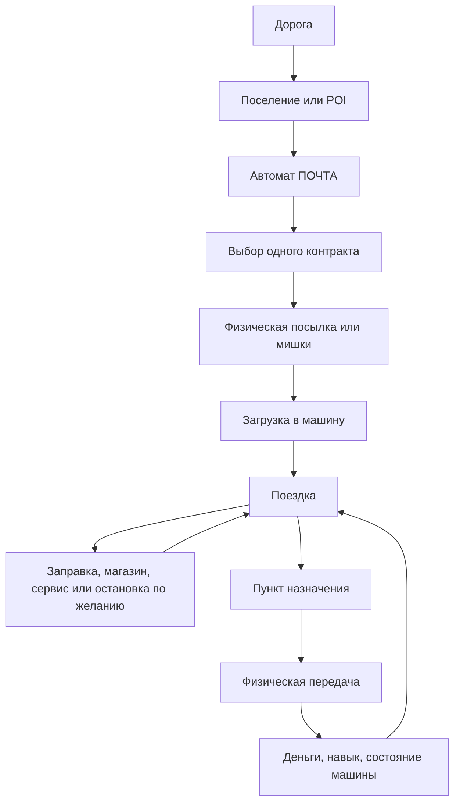

# Voyage Mirage — новая концепция игры

> Рабочий дизайн-документ второй итерации. Старый документ сохранён в `GAME_DESIGN.md` как история предыдущего направления. Этот файл описывает новое решение: одна дорога, единый мир, физические контракты и маленькие придорожные поселения.

## 1. Короткая формулировка

**Voyage Mirage** — игра о старых автомобилях, дороге и поручениях.

Игрок начинает на ВАЗ-1111 Оке и постепенно становится лучше как водитель. Он забирает физические предметы, загружает их в машину, везёт их в другие места, перевозит пассажиров-плюшевых мишек, заправляется, покупает расходники и выбирает рискованный или спокойный способ движения.

Главное обещание:

> Я сам управляю машиной и всем, что связано с поездкой.

В игре нет отдельных режимов «миссия» и «фрирайд». Есть один процедурный мир и текущая задача, которая может быть активной или отсутствовать.

```text
Есть активный контракт → игрок едет по делу.
Нет активного контракта → игрок просто едет.
```

Контракт — это не отдельный уровень, а состояние мира.

---

## 2. Главные решения этой итерации

1. Комната — атмосферная энциклопедия автомобилей, а не карьерный хаб.
2. Мальчик не обязан спать и видеть буквальные сны. Комната только намекает на его увлечение машинами.
3. Единственный сохраняемый режим начинается на Оке.
4. После доставки можно продолжать ехать по тому же миру.
5. Контракты выбираются физически в автомате `ПОЧТА` из нескольких предложений.
6. Первый вариант использует один активный контракт за раз.
7. Пассажиры — плюшевые мишки. Контракт случайно определяет количество: от одного до трёх.
8. Все доступные машины оснащены пассажирскими местами и могут выполнять пассажирские контракты.
9. Мишки и вещи не выпадают с сидений. G-force влияет на комфорт и качество поездки, но не разрушает физическую сцену.
10. Придорожные POI становятся маленькими поселениями из нескольких домов.
11. В пределах одного поселения все дома используют один тип строения.
12. Квестовые машины, надувные кактусы-зазывалы и вкопанные машины убираются из мира.
13. Павшие вышки полностью исключаются из генерации POI.
14. Заправка на POI — это не каноническая автозаправочная станция, а редкая группа бочек с небольшим остатком жидкости.
15. Машины иногда продаются прямо на POI. Игрок покупает их физически и продолжает поездку уже на новой машине.


---

## 3. Комната и подача без объяснений

Комната мальчика остаётся атмосферной автомобильной энциклопедией — аналогом `Carcyclopedia` из первой Mafia.

Она не является карьерным экраном, гаражом, диспетчерской или обязательным промежуточным пунктом. Игрок не должен возвращаться в комнату, чтобы принять каждый следующий контракт.

На сцене могут быть:

- коврик с игрушечной машинкой и дорогой;
- стол с учебниками и тетрадями;
- карандаши, ручки, ластики;
- детские рисунки машин и дорог на стенах;
- карта с отмеченными местами;
- карточки или модели автомобилей;
- список уже увиденных и купленных моделей;
- наклейки, конверты, чеки и маленькие предметы, накопленные за поездки.

Комната ничего не объясняет словами. Игрок сам понимает, что мальчик увлечён автомобилями.

Её функции:

- посмотреть модели автомобилей;
- увидеть, какие машины уже встречались или были куплены;
- рассмотреть характеристики и внешний вид;
- открыть настройки;
- начать единственный сохраняемый режим.

Выбор активной машины происходит не в комнате, а там, где игрок физически купил её. После покупки игрок садится в неё и едет дальше.

---

## 4. Единый мир и единый цикл

В мире есть дороги, POI, поселения, магазины, почтовые автоматы, бочки, курьеры, трафик, машины и контракты.

Основной цикл:



После доставки игрок может:

- взять следующий контракт в том же поселении;
- продолжить дорогу без контракта;
- купить машину, если на этом POI она продаётся;
- искать новое место или ресурс;
- принять другой контракт позже.

Не должно быть обязательного «успех → затемнение → меню → новая миссия».

---

## 5. Обучение через предметы

Обучение не является отдельным уровнем и не требует диалогов.

Первая поездка должна быть собрана как цепочка физических причин:

1. Игрок видит автомат `ПОЧТА`.
2. Крутит его селектор и выбирает простой контракт.
3. Автомат выдаёт настоящую посылку.
4. Игрок открывает багажник.
5. Кладёт посылку внутрь.
6. Видит название пункта назначения на упаковке или рядом с ней.
7. На дороге встречает указатель этого населённого пункта.
8. Приезжает в другое поселение.
9. Передаёт посылку в почтовый автомат или локальный приёмный слот.
10. Получает деньги и продолжает ехать.

Следующие системы вводятся самими обстоятельствами:

- пустой бак заставляет искать топливо;
- бочки предлагают физически наполнить канистру;
- хрупкий груз требует плавного движения;
- мишки требуют открыть двери и рассадить пассажиров;
- ночной контракт требует пользоваться фарами;
- большой груз объясняет выбор универсала или фургона;
- плохая дорога объясняет другой автомобиль.

Разрешённый текст — только функциональный и пространственный:

- название контракта;
- название населённого пункта;
- цена;
- подпись предмета или автомата;
- короткая подсказка над тем, с чем можно взаимодействовать.

Не нужны:

- диалоги персонажей;
- письма;
- длинные объяснения;
- голосовые инструкции;
- сюжетные окна между поездками.

---

## 6. Придорожные POI как маленькие поселения

### 6.1. Общая структура мира

Не каждый POI должен быть поселением. В мире нужны разные масштабы:

```text
одиночный дом       — редкая жилая остановка
маленькое местечко  — 4–5 домов, почта и магазин
крупное местечко    — 6–7 домов, почта, магазин и иногда бочки
```

Большинство случайных домов могут остаться одиночными. Поселения должны встречаться достаточно редко, чтобы читаться как настоящие места на дороге.

### 6.2. Один тип домов на одно поселение

Поселение получает один тип дома от исходного детерминированного roll.

Примеры:

- POI получил `izba` → все дома поселения — разные избы одного типа;
- POI получил `dacha` → все дома — дачи;
- POI получил `pueblo` → несколько пуэбло;
- POI получил `airstream` → группа трейлеров одного типа.

Различие между домами одного поселения может появляться через:

- ориентацию;
- состояние и weathering;
- небольшие дворовые предметы;
- заборы и хозяйственные детали;
- расстояние до дороги;
- положение на участке.

Не следует смешивать пять архитектурных стилей в одном маленьком поселении. Это превращает место в каталог моделей, а не в населённый пункт.

### 6.3. Рекомендованный layout

Базовый вариант — пять домов и сервисы на одной стороне дороги:

```text
                         ДАЛЬНЯЯ СТОРОНА

                 дом          дом          дом
              двор / забор  двор / забор  двор

============================== ДОРОГА ==============================  →

      дом        ПОЧТА       парковка       МАГАЗИН        дом
                         длинная lay-by
                         БОЧКИ (иногда)
                         БЛИЖНЯЯ СТОРОНА
```

Сервисы находятся на одной стороне, чтобы игроку не приходилось постоянно пересекать дорогу между почтой и магазином. Дома всё равно стоят по обеим сторонам и дают ощущение местечка.

Рекомендуемые пропорции для первого прототипа:

- общая длина поселения: примерно 80–120 м;
- 2–3 дома на каждой стороне;
- расстояние между домами: не меньше нескольких метров после учёта реального bounding box;
- крупные строения занимают больше места, а не пересекаются с соседями;
- один общий сервисный участок у дороги;
- здания стоят в существующем диапазоне отступа от асфальта;
- проезжая часть и линии движения трафика не меняются.

Точные числа должны быть проверены отдельным инструментом размещения. Нельзя рассчитывать зазоры только по авторскому `footprint`: коллайдер дома берётся из фактического тела здания.

### 6.4. Зоны поселения

У поселения должны быть отдельные смысловые зоны:

#### Жилая зона

- дома одного типа;
- заборы;
- дворы;
- дрова, бочки, бельё, сараи и другие визуальные детали;
- минимум интерактивных объектов.

#### Почтовая зона

- автомат `ПОЧТА`;
- парковочное место;
- место для физической выдачи посылок;
- указатель ближайших населённых пунктов;
- место для курьера только там, где он нужен для специального контракта.

#### Магазинная зона

- автомат `МАГАЗИН`;
- небольшая площадка перед ним;
- лоток выдачи;
- видимые товары в окне;
- наклейки, жвачка, очки и расходники.

#### Топливная зона

Появляется не всегда.

- несколько неподвижных бочек;
- отдельная бочка для воды, масла и бензина;
- короткая надпись или цветовой знак;
- место для канистры и рук игрока;
- никакой полноценной бензоколонки.

### 6.5. Ограничения генерации

Дома не должны пересекаться. Если здание большое, оно занимает больше места и уменьшает количество домов в поселении либо растягивает поселение вдоль дороги.

Нужно проверять:

- bounding box настоящей геометрии здания;
- расстояние до дороги;
- расстояние до lay-by;
- расстояние до автоматов;
- расстояние до бочек;
- расстояние между домами;
- близость к другим проходам дороги;
- пригодность участка для общей площадки;
- пересечение с landform, mesa или lake.

В первом варианте следует строить поселения на достаточно спокойном участке дороги, а не пытаться разместить их на сложном склоне или возле hairpin.

### 6.6. Что удалить из POI

Из мира полностью убрать:

- машины квестодателей;
- надувного кактуса-зазывалу;
- вкопанные машины и поля старых кузовов;
- павшие вышки.

Курьерские машины и специальные рекламные объекты больше не должны быть обязательным визуальным языком контрактов. Контракт должен объясняться почтовым автоматом и физическим грузом.

Стоящие или работающие мачты могут остаться как отдельные редкие объекты инфраструктуры, если они нужны для разнообразия пустыни. `fallen-tower` в генерации не используется.

---

## 7. Автомат ПОЧТА

### 7.1. Назначение

`ПОЧТА` — физический источник контрактов.

Он показывает несколько уже сгенерированных предложений. Игрок сам выбирает, что взять.

Количество предложений в первом варианте: 3–4.

Контракт выбирается из существующей системы предложений, а автомат является физическим интерфейсом к ней. Не создавать отдельную экономику только для поселений.

### 7.2. Механические действия

Рекомендуемая последовательность:

1. повернуть селектор или диск;
2. прокрутить предложения;
3. увидеть выбранное название, направление и груз;
4. нажать фиксатор;
5. потянуть рычаг выдачи;
6. открыть маленькую дверцу;
7. забрать посылку из лотка;
8. физически отнести её к машине.

На автомате допустимы короткие надписи:

- `ПОЧТА`;
- название контракта;
- пункт назначения;
- награда;
- тип груза.

### 7.3. Один активный контракт

В начале игрок выбирает одно поручение. Посылка должна существовать как реальный предмет и занимать место в машине или руках.

Позже навык или вместительная машина могут открыть несколько одновременных контрактов, но это не является базовой системой. Начальная игра должна оставаться читаемой:

```text
выбрать один заказ
→ взять один груз
→ довезти
→ получить результат
```

### 7.4. Сдача

Обычный контракт сдаётся физически:

- в почтовый слот назначения;
- в автомат с соответствующим знаком;
- в специальный приёмный ящик;
- в редком случае — курьеру.

Дисковый набор не обязателен для каждой доставки.

Он используется для особых отправлений:

- заказное;
- дорогое;
- медицинское;
- закрытое;
- контракт высокого навыка.

Так дисковый набор становится осмысленной механикой, а не универсальным препятствием перед финишем.

---

## 8. Автомат МАГАЗИН

На поселении может стоять один автомат `МАГАЗИН`.

Он использует физическую выдачу через окно, селектор, рычаг и лоток. Все товары покупаются и становятся настоящими предметами.

Ассортимент одного автомата:

- 1–2 баллончика с краской случайного цвета;
- очки;
- воздушный фильтр;
- турбина;
- пустые канистры;
- жвачка;
- 4–5 случайных стикеров в конвертах.

Ассортимент может быть неполным: конкретный автомат не обязан содержать всё сразу.

Наклейки выбираются случайно, но после покупки становятся постоянным предметом. Баллончики имеют цвет, который виден до покупки.

Очки — уже существующий предмет игры и должны использоваться без создания отдельной системы инвентаря.

Пустая канистра — это не запас жидкости. Она сама по себе ничего не даёт и должна быть наполнена у бочки или другого доступного источника.

---

## 9. Бочки с жидкостями

Иногда на POI встречается маленькая топливно-хозяйственная зона.

Это не автозаправка и не магазин топлива. Это несколько неподвижных бочек, оставленных у дома или магазина.

Типы:

- вода;
- масло;
- бензин.

Каждый тип имеет собственный цвет бочки. Цвет должен быть различим ночью и при плохой погоде.

В бочках обычно очень мало жидкости:

- примерно пара литров;
- иногда меньше;
- иногда бочка полностью пустая.

Бочки должны ощущаться как случайная помощь в дороге, а не как способ полностью заправить машину бесплатно.

### 9.1. Заправка из бочки

Игрок:

1. покупает пустую канистру в автомате `МАГАЗИН`;
2. подходит к нужной бочке;
3. открывает крышку или берёт шланг;
4. ставит канистру под слив;
5. тянет ручку;
6. ждёт, пока доступный остаток перетечёт;
7. забирает частично наполненную канистру;
8. использует её у машины.

Одна канистра не должна автоматически наполняться до максимума. Игрок видит реальное количество жидкости.

---

## 10. Пассажиры-плюшевые мишки

Пассажиры — не люди и не NPC с репликами. Это плюшевые мишки, которых ребёнок представляет пассажирами.

Каждый пассажирский контракт случайно выбирает количество:

```text
1 пассажир, 2 пассажира или 3 пассажира
```

Количество фиксируется контрактом и не меняется игроком вручную.

Все доступные автомобили оснащены пассажирскими местами. Контракт не требует установки специального оборудования.

Игрок должен:

- достать каждого мишку;
- открыть боковую дверь;
- выбрать место;
- посадить мишку;
- закрыть дверь;
- довезти пассажиров;
- высадить их в пункте назначения.

Мишки занимают реальные пассажирские места и не должны сидеть на полу или в багажнике. Они блокируют занятое сиденье так же, как другой физический объект блокирует место.

### 10.1. Без выпадения

Пассажиры не выпадают из сидений.

Также не следует ронять обычный предмет с сиденья только из-за резкого торможения. Это не даёт полезного выбора и превращает физическую систему в случайное наказание.

Состояние посадки сохраняется стабильным. Жёсткое движение влияет на оценку поездки, а не на положение мишки.

---

## 11. G-force и качество поездки

Для пассажирских и хрупких контрактов на экране появляется компактный индикатор перегрузок.

Индикатор показывает:

- направление текущего ускорения;
- величину продольной и боковой перегрузки;
- безопасную зону;
- неприятную зону;
- резкий момент.

Пассажир не падает, но поездка становится хуже, если игрок:

- резко разгоняется;
- резко тормозит;
- агрессивно входит в поворот;
- часто меняет направление;
- едет слишком быстро по плохому покрытию.

Текущие пороги комфорта из `TripRecord` можно использовать как основу:

- около `2.5 m/s²` — заметное снижение комфорта;
- около `3.5 m/s²` — жёсткий момент.

Для обычного груза индикатор не обязан постоянно отображаться. Для мишек, хрупкого предмета и пассажирских контрактов он становится частью управления.

Результат поездки сообщает последствия коротко:

- пассажиры доехали спокойно;
- были резкие моменты;
- автомобиль получил повреждения;
- груз сохранён или пострадал;
- контракт выполнен вовремя или с опозданием.

Без диалогов и без голосовых реакций.

---

## 12. Навыки доставки

Карьеры, глав и отдельного прогресса меню нет. Есть один сохраняемый мир. В сохранении лежит то, что у игрока есть сейчас: машина, деньги, вещи, выполненные доставки.

Счётчик выполненных доставок по видам открывает в `ПОЧТЕ` более сложные предложения, как в ETS2:

1. **Посылки** — обычные короткие доставки.
2. **Дальность** — более длинные маршруты.
3. **Аккуратность** — лампы, стекло, хрупкие предметы.
4. **Пассажиры** — мишки, один–три пассажира, требования к комфорту.
5. **Крупные грузы** — большие вещи, которые помещаются не в каждую машину.
6. **Срочность** — мягкие и жёсткие дедлайны.
7. **Ночь и погода** — маршруты в сложных условиях.

Навык влияет только на то, какие предложения показывает `ПОЧТА`, и на награду. Машины он не открывает.

---

## 13. Автомобили

### 13.1. Старт

Новая игра начинается на Оке. На какой машине игрок едет, на той он и остаётся, пока не купит другую.

Нет гаража, коллекции машин и выбора машины в меню.

### 13.2. Машина на продажу на POI

Иногда на POI стоит одна машина на продажу: настоящая, с работающими дверями, капотом и багажником. Рядом — табличка с моделью и ценой.

Какие модели и почём стоят, зависит от того, как далеко от начала дороги находится POI (как сейчас в `src/world/carlot.ts`): ближе к дому — дешёвые отечественные, дальше — дороже, иномарки только далеко.

### 13.3. Как купить физически

Машина покупается не через автомат `МАГАЗИН` (он для мелочей), а через маленький ящик с ключом у таблички:

1. осмотреть машину: открыть двери, капот, багажник;
2. бросить монеты в щель ящика;
3. потянуть рычаг;
4. из лотка выпадает ключ;
5. взять ключ — табличка снимается, машина теперь игрока;
6. переложить вещи, сесть и уехать.

Не хватает монет — рычаг не поддаётся, подсказка показывает, сколько не хватает.

### 13.4. Что со старой машиной

Старая машина остаётся стоять на этом POI и сохраняется там: из неё можно забрать вещи, слить бензин в канистру, вернуться и пересесть обратно.

[Решение открыто] Альтернатива — продавец забирает старую машину в зачёт и делает скидку. Проще, но тогда нельзя вернуться к своей машине.

### 13.5. Роли автомобилей

Новая машина должна давать другой способ ездить, а не только больше скорости:

- Ока — простая, дешёвая, экономичная, мало места;
- универсал — больше места для груза и мишек;
- Нива — уверенно на плохом покрытии;
- седан — устойчивый и комфортный на трассе;
- фургон — много места, но медленный;
- мощная старая машина — быстрая, но прожорливая.

У всех машин есть пассажирские места для мишек. Разница — в поведении, вместимости, расходе и комфорте.

---

## 14. Деньги, магазин и расходы

Деньги выдаются за выполненные контракты и используются для:

- покупки автомобилей;
- топлива и жидкостей, если их продажа будет введена;
- ремонта;
- пустых канистр;
- баллончиков;
- стикеров;
- очков;
- расходников.

Маленький остаток в бочках не должен отменять важность нормальной подготовки машины. Бочки помогают пережить плохую ситуацию, но не заменяют магазин и планирование.

Экономика должна вознаграждать хорошее вождение, но не превращать каждую поездку в обязательное выживание.

---

## 15. Что должно исчезнуть из старой концепции

Из пользовательской подачи и основного цикла убрать:

- буквальные сны;
- обязательное пробуждение за пределами миссионного коридора;
- отдельный режим `Free drive` как вторую игру;
- возврат в комнату после каждой доставки;
- обязательный PIN перед каждой сдачей;
- машины квестодателей;
- надувного кактуса-зазывалу;
- вкопанные машины;
- павшие вышки;
- выпадение предметов и мишек с сидений.

В коде старые структуры `src/dreams/` могут временно оставаться внутренним этапом миграции, но новая пользовательская модель не должна добавлять новые контракты в параллельную dream-систему.

---

## 16. Рекомендуемый порядок разработки

### Этап 1 — ручной прототип поселения

Сделать один тестовый POI:

- пять домов одного типа;
- дома не пересекаются по фактическому bounding box;
- дома стоят по обеим сторонам дороги;
- сервисы на одной стороне;
- один общий парковочный участок;
- автомат `ПОЧТА`;
- автомат `МАГАЗИН`;
- несколько дворовых объектов;
- без машин квестодателей и вкопанных машин.

Цель — проверить, что место воспринимается как населённый пункт.

### Этап 2 — почтовый автомат

- несколько существующих контрактных предложений;
- механический выбор;
- один активный контракт;
- настоящая посылка;
- физическая выдача;
- физическая сдача.

### Этап 3 — единый мир

- контракт не загружает отдельный сон;
- маршрут не заканчивает мир;
- после сдачи можно продолжить движение;
- отсутствие контракта становится свободной ездой.

### Этап 4 — магазин и бочки

- магазинный автомат;
- существующая жвачка;
- конверты с наклейками;
- очки;
- баллончики;
- пустые канистры;
- несколько цветных бочек с ограниченным запасом.

### Этап 5 — качество поездки

- убрать выпадение;
- добавить G-force индикатор;
- связать его с комфортом и результатом.

### Этап 6 — один мишка

- получить контракт с одним пассажиром;
- взять мишку;
- посадить;
- довезти;
- высадить.

После проверки добавить контракты на двух и трёх пассажиров.

### Этап 7 — машина на продажу

- одна машина на продажу на тестовом POI;
- табличка с ценой;
- ящик с монетной щелью, рычагом и ключом;
- покупка и пересадка без выхода из игры;
- старая машина остаётся на POI.

### Этап 8 — процедурные поселения

Только после успешного ручного прототипа перенести layout в генератор:

- одиночный дом;
- маленькое местечко;
- крупное местечко;
- редкие бочки;
- детерминированный тип дома на поселение;
- общая проверка коллизий и terrain.

---

## 17. Итоговая модель

```text
Ребёнок играет в водителя.

Комната намекает на это предметами.
Дорога остаётся одним непрерывным миром.
Поселения дают дороге человеческий масштаб.
ПОЧТА даёт выбор физического контракта.
МАГАЗИН даёт предметы и расходники.
Бочки иногда спасают в дороге.
Мишки становятся пассажирами.
G-force оценивает мастерство.
Ока даёт начало.
Машину покупаешь прямо на дороге и едешь дальше на ней.
```

Игра должна приводить игрока не к следующему «сну», а к следующей мысли:

> Куда я поеду теперь и на чём?
