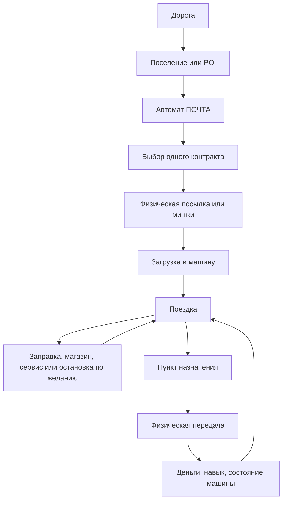

# Voyage Mirage — новая концепция игры

> Рабочий дизайн-документ второй итерации. Старый документ сохранён в `GAME_DESIGN.md` как история предыдущего направления. Этот файл описывает новое решение: одна дорога, единый мир, физические контракты и маленькие придорожные поселения.

## 1. Короткая формулировка

**Voyage Mirage** — игра о старых автомобилях, дороге и поручениях.

Игрок начинает на ВАЗ-1111 Оке и постепенно становится лучше как водитель. Он забирает физические предметы, загружает их в машину, везёт их в другие места, перевозит пассажиров-плюшевых мишек, заправляется, покупает расходники и выбирает рискованный или спокойный способ движения.

Главное обещание:

> Я сам управляю машиной и всем, что связано с поездкой.

В игре нет отдельных режимов «миссия» и «фрирайд». Есть один процедурный мир и текущая задача, которая может быть активной или отсутствовать.

```text
Есть активный контракт → игрок едет по делу.
Нет активного контракта → игрок просто едет.
```

Контракт — это не отдельный уровень, а состояние мира.

---

## 2. Главные решения этой итерации

1. Комната — атмосферная энциклопедия автомобилей, а не карьерный хаб.
2. Мальчик не обязан спать и видеть буквальные сны. Комната только намекает на его увлечение машинами.
3. Единственный сохраняемый режим начинается на Оке.
4. После доставки можно продолжать ехать по тому же миру.
5. Контракты выбираются физически в автомате `ПОЧТА` из нескольких предложений.
6. Первый вариант использует один активный контракт за раз.
7. Пассажиры — плюшевые мишки. Контракт случайно определяет количество: от одного до трёх.
8. Все доступные машины оснащены пассажирскими местами и могут выполнять пассажирские контракты.
9. Мишки и вещи не выпадают с сидений. G-force влияет на комфорт и качество поездки, но не разрушает физическую сцену.
10. Придорожные POI становятся маленькими поселениями из нескольких домов.
11. В пределах одного поселения все дома используют один тип строения.
12. Квестовые машины, надувные кактусы-зазывалы и вкопанные машины убираются из мира.
13. Павшие вышки полностью исключаются из генерации POI.
14. Заправка на POI — это не каноническая автозаправочная станция, а редкая группа бочек с небольшим остатком жидкости.
15. Машины иногда продаются прямо на POI. Игрок покупает их физически и продолжает поездку уже на новой машине.


---

## 3. Комната и подача без объяснений

Комната мальчика остаётся атмосферной автомобильной энциклопедией — аналогом `Carcyclopedia` из первой Mafia.

Она не является карьерным экраном, гаражом, диспетчерской или обязательным промежуточным пунктом. Игрок не должен возвращаться в комнату, чтобы принять каждый следующий контракт.

На сцене могут быть:

- коврик с игрушечной машинкой и дорогой;
- стол с учебниками и тетрадями;
- карандаши, ручки, ластики;
- детские рисунки машин и дорог на стенах;
- карта с отмеченными местами;
- карточки или модели автомобилей;
- список уже увиденных и купленных моделей;
- наклейки, конверты, чеки и маленькие предметы, накопленные за поездки.

Комната ничего не объясняет словами. Игрок сам понимает, что мальчик увлечён автомобилями.

Её функции:

- посмотреть модели автомобилей;
- увидеть, какие машины уже встречались или были куплены;
- рассмотреть характеристики и внешний вид;
- открыть настройки;
- начать единственный сохраняемый режим.

Выбор активной машины происходит не в комнате, а там, где игрок физически купил её. После покупки игрок садится в неё и едет дальше.

---

## 4. Единый мир и единый цикл

В мире есть дороги, POI, поселения, магазины, почтовые автоматы, бочки, курьеры, трафик, машины и контракты.

Основной цикл:



После доставки игрок может:

- взять следующий контракт в том же поселении;
- продолжить дорогу без контракта;
- купить машину, если на этом POI она продаётся;
- искать новое место или ресурс;
- принять другой контракт позже.

Не должно быть обязательного «успех → затемнение → меню → новая миссия».

---

## 5. Обучение через предметы

Обучение не является отдельным уровнем и не требует диалогов.

Первая поездка должна быть собрана как цепочка физических причин:

1. Игрок видит автомат `ПОЧТА`.
2. Крутит его селектор и выбирает простой контракт.
3. Автомат выдаёт настоящую посылку.
4. Игрок открывает багажник.
5. Кладёт посылку внутрь.
6. Видит название пункта назначения на упаковке или рядом с ней.
7. На дороге встречает указатель этого населённого пункта.
8. Приезжает в другое поселение.
9. Передаёт посылку в почтовый автомат или локальный приёмный слот.
10. Получает деньги и продолжает ехать.

Следующие системы вводятся самими обстоятельствами:

- пустой бак заставляет искать топливо;
- бочки предлагают физически наполнить канистру;
- хрупкий груз требует плавного движения;
- мишки требуют открыть двери и рассадить пассажиров;
- ночной контракт требует пользоваться фарами;
- большой груз объясняет выбор универсала или фургона;
- плохая дорога объясняет другой автомобиль.

Разрешённый текст — только функциональный и пространственный:

- название контракта;
- название населённого пункта;
- цена;
- подпись предмета или автомата;
- короткая подсказка над тем, с чем можно взаимодействовать.

Не нужны:

- диалоги персонажей;
- письма;
- длинные объяснения;
- голосовые инструкции;
- сюжетные окна между поездками.

---

## 6. Придорожные POI как маленькие поселения

### 6.1. Общая структура мира

Не каждый POI должен быть поселением. В мире нужны разные масштабы:

```text
одиночный дом       — редкая жилая остановка
маленькое местечко  — 4–5 домов, почта и магазин
крупное местечко    — 6–7 домов, почта, магазин и иногда бочки
```

Большинство случайных домов могут остаться одиночными. Поселения должны встречаться достаточно редко, чтобы читаться как настоящие места на дороге.

### 6.2. Один тип домов на одно поселение

Поселение получает один тип дома от исходного детерминированного roll.

Примеры:

- POI получил `izba` → все дома поселения — разные избы одного типа;
- POI получил `dacha` → все дома — дачи;
- POI получил `pueblo` → несколько пуэбло;
- POI получил `airstream` → группа трейлеров одного типа.

Различие между домами одного поселения может появляться через:

- ориентацию;
- состояние и weathering;
- небольшие дворовые предметы;
- заборы и хозяйственные детали;
- расстояние до дороги;
- положение на участке.

Не следует смешивать пять архитектурных стилей в одном маленьком поселении. Это превращает место в каталог моделей, а не в населённый пункт.

### 6.3. Рекомендованный layout

Базовый вариант — пять домов и сервисы на одной стороне дороги:

```text
                         ДАЛЬНЯЯ СТОРОНА

                 дом          дом          дом
              двор / забор  двор / забор  двор

============================== ДОРОГА ==============================  →

      дом        ПОЧТА       парковка       МАГАЗИН        дом
               длинная lay-by, сервисная полоса на её асфальте
     павильон мишек · ряд из трёх косых мест \ \ \ · колонки (иногда)
                         БЛИЖНЯЯ СТОРОНА
```

Площадка поселения — асфальт шириной 12 м от края дороги: 8.5 м проезда и стоянки плюс сервисная полоса 3.5 м у внешнего края. Вся мебель почты — автомат `ПОЧТА`, коробка с машинками, павильон мишек, автомат `МАГАЗИН`, колонки — стоит на этом асфальте, спиной в 0.4 м от его края, лицом к дороге, а не на песке за краем (владелец, 2026-10-25). За краем на песке остаётся только указатель.

Сервисная полоса (метры вдоль дороги от остановки):

| Вдоль | Что | Размер |
|---|---|---|
| −26 | указатель (на песке за краем асфальта) | как раньше |
| −9.8 | павильон мишек: только лавка и односкатный навес над ней на двух металлических стойках, без стенок; табличка-расписание на стойке (оплата идёт на счёт, §7.7) | навес 3,5 × 1,3 м, лавкой к площадке |
| −5.6 | автомат `ПОЧТА` | автомат |
| −2.7 | коробка с машинками; её машина встаёт на асфальт перед ней | автомат |
| +1…+18 | ряд из трёх косых парковочных мест: 1 — груз перевозки ждёт здесь, 2 — сдача перевозок, 3 — машина на продажу (иногда; иначе место пустое) | каждое 3.5 × 6.6 м, под 45° к дороге |
| +21.5 | автомат `МАГАЗИН` | автомат |
| +24…+28 | колонки: бензин, масло, вода (иногда) | три в ряд у края площадки |

Ряд мест — «ёлочка» `\ \ \`: белые линии на асфальте, три прямоугольника бок о бок под 45° к дороге, наклонённые по ходу движения на этой стороне. Водитель проезжает мимо места, останавливается и сдаёт в него задом, а уезжает передом туда же, куда ехал. Так въезжают в место сдачи с прицепом (§7.8), и так же стоит ждущий груз: дышлом к выезду. Ширина места 3.5 м — машина и проход между соседними машинами, чтобы открыть дверь; глубина 6.6 м — прицеп КМЗ с дышлом или самая длинная машина (ГАЗ-31029, 4.88 м) с запасом. У въезда в каждое место нарисован его номер; номера идут по ходу движения, место 1 водитель встречает первым. Ряд прямой, по касательной к дороге в его середине, поэтому на повороте стороны соседних мест не расходятся.

Загона на песке за краем площадки больше нет: он выглядел чужеродно (владелец, 2026-10-25). У мест нет ни стенок, ни бордюров — только краска.

Запасных прицепов на площадках больше нет: прицеп появляется только как груз контракта.

Сервисы находятся на одной стороне, чтобы игроку не приходилось постоянно пересекать дорогу между почтой и магазином. Дома всё равно стоят по обеим сторонам и дают ощущение местечка.

Рекомендуемые пропорции для первого прототипа:

- общая длина поселения: примерно 80–120 м;
- 2–3 дома на каждой стороне;
- расстояние между домами: не меньше нескольких метров после учёта реального bounding box;
- крупные строения занимают больше места, а не пересекаются с соседями;
- один общий сервисный участок у дороги;
- здания стоят в существующем диапазоне отступа от асфальта;
- проезжая часть и линии движения трафика не меняются.

Точные числа должны быть проверены отдельным инструментом размещения. Нельзя рассчитывать зазоры только по авторскому `footprint`: коллайдер дома берётся из фактического тела здания.

### 6.4. Зоны поселения

У поселения должны быть отдельные смысловые зоны:

#### Жилая зона

- дома одного типа;
- заборы;
- дворы;
- дрова, бочки, бельё, сараи и другие визуальные детали;
- минимум интерактивных объектов.

#### Почтовая зона

- автомат `ПОЧТА`;
- коробка с машинками;
- ряд из трёх косых парковочных мест: перевозки (выдача и сдача) и машина на продажу;
- павильон мишек;
- указатель ближайших населённых пунктов.

#### Магазинная зона

- автомат `МАГАЗИН`;
- небольшая площадка перед ним;
- лоток выдачи;
- видимые товары в окне;
- наклейки, жвачка, очки и расходники.

#### Колонки

Стоят не в каждом посёлке. Три колонки — бензин, масло, вода — со шлангом и пистолетом (§9). Бочек больше нет нигде, ни в посёлках, ни у одиноких домов.

### 6.5. Ограничения генерации

Дома не должны пересекаться. Если здание большое, оно занимает больше места и уменьшает количество домов в поселении либо растягивает поселение вдоль дороги.

Нужно проверять:

- bounding box настоящей геометрии здания;
- расстояние до дороги;
- расстояние до lay-by;
- расстояние до автоматов;
- расстояние до бочек;
- расстояние между домами;
- близость к другим проходам дороги;
- пригодность участка для общей площадки;
- пересечение с landform, mesa или lake.

В первом варианте следует строить поселения на достаточно спокойном участке дороги, а не пытаться разместить их на сложном склоне или возле hairpin.

### 6.6. Что удалить из POI

Из мира полностью убрать:

- машины квестодателей;
- надувного кактуса-зазывалу;
- вкопанные машины и поля старых кузовов;
- павшие вышки.

Курьерские машины и специальные рекламные объекты больше не должны быть обязательным визуальным языком контрактов. Контракт должен объясняться почтовым автоматом и физическим грузом.

Стоящие или работающие мачты могут остаться как отдельные редкие объекты инфраструктуры, если они нужны для разнообразия пустыни. `fallen-tower` в генерации не используется.

---

## 7. Автомат ПОЧТА и контракты

> Видение от 2026-10-25. Текущие контракты (`src/contracts/`) — ранний прототип; эта глава описывает систему, которой они заменяются.

### 7.1. Назначение

`ПОЧТА` — источник контрактов на вещи. Вещь появляется из её лотка. Перевозки (прицеп, буксир, перегон) стоят на месте 1 парковочного ряда, мишки сидят в павильоне: их контракт берётся не вещью из лотка (§7.8, §10).

Мальчик возит не «посылки», а вещи из своей комнаты и своей жизни: старый телевизор, аквариум, пачку карандашей, посудный сервиз, ковёр, удочки, настольную лампу, подушки.

### 7.2. Карточки

В автомате 4 постоянные карточки:

1. обычная вещь;
2. хрупкая вещь;
3. габаритная вещь — или перевозка: прицеп, машина на буксир, машина своим ходом;
4. особая вещь — только если на площадке почты стоит машина с достаточной уникальностью (§12).

Мишки — не карточка автомата, а павильон (§10).

«Срочно» и «гонка» — модификаторы поверх любой карточки, их добавляет почта при выдаче.

Взятая карточка сразу заменяется следующей того же свойства: автомат не пустеет.

Карточка показывает вещь, пункт назначения, расстояние, оплату, теги и помечает, если вещь не влезет в машину на площадке. Выдаёт она в любом случае: машину можно сменить (§13.4).

### 7.3. Вещи и теги

У каждой вещи каталога постоянные теги, их может быть несколько: `обычная`, `габаритная`, `хрупкая`. Срочность вешает почта.

| Вещь | Где едет | Теги |
|---|---|---|
| пачка карандашей, глобус | 1 ячейка | обычная / хрупкая |
| подушки | 2 ячейки или сиденье | обычная |
| настольная лампа, сервиз, проигрыватель | 2 ячейки | хрупкая |
| ящик папиных инструментов | 2 ячейки, 30 кг | обычная, тяжёлая |
| удочки, санки | полоса 1×4 | габаритная |
| ковёр | вся задняя скамья | габаритная |
| старый телевизор, аквариум | 2×2 | габаритная + хрупкая |
| шкаф, пианино, диван, кровать | прицеп | габаритная |
| сломанная машинка «в ремонт» | на буксире | — |
| машинка «отвезти другу» | своим ходом (перегон) | — |

Груз прицепа стоит в кузове КМЗ (внутри 1.85 × 1.2 м) между бортами, вплотную к переднему борту. Шкаф и диван помещаются с поднятым задним бортом. Кровать (2.0 × 1.14 м) длиннее кузова: она стоит у переднего борта и выступает назад, а задний борт снят. Передний и боковые борта на месте всегда.

Особые вещи (дедушкин приёмник, альбом марок и т. п.) — отдельный список, только через карточку особой вещи.

### 7.4. Лимит и брошенные вещи

Одновременно — не больше **3 активных контрактов** у игрока, и среди них не больше **одной перевозки** (прицеп, буксир или перегон): тянуть можно что-то одно. Мишки, взятые с одного павильона, — один контракт. Лимитов на машину нет: в неё лезет то, что физически помещается.

Ничего не сгорает. Вещь — игрушка мальчика: она лежит там, где её оставили, и сохраняется.

Любая почта принимает вещь назад («вернуть отправителю»): без денег, контракт закрывается, слот лимита освобождается. Сломанную вещь любая почта тоже забирает как возврат, чтобы от неё можно было избавиться. Перевозка возвращается так же, как сдаётся: заездом на место 2 любой почты (§7.8), без денег. Мишку возвращают только в его павильон (§10).

Активный контракт — вещь, мишка или перевозка вне своего места выдачи (в руках, в рюкзаке, в машине, на земле, на сцепке), не сломанная, не сданная и не возвращённая.

### 7.5. Срочность

Таймер срочного контракта — секунды симуляции с момента TAKE. Он не связан с временем суток: стоит на паузе, в меню и при перемотке суток. Таймер хранится на предмете.

Опоздание мягкое: сгорает надбавка за срочность, вещь всё равно принимают за базовую оплату.

Числа: срочной почта делает ~25% предложений любой карточки (кроме самого первого в поездке). Срок — км по дороге до назначения при 45 км/ч плюс 2 минуты, с округлением вверх до 10 с (3 км — 6:00). Надбавка вовремя — +50% оплаты. Остаток показывают карточка, подпись предмета и строка маршрута на HUD.

### 7.6. Гонки

Модификатор «гонка» на 1 или 2 перегона: три соперника везут такую же вещь, победа добавляет оплату. Механика прототипа (`contracts/race.ts`) сохраняется.

Реализация: гонкой может быть карточка обычной, хрупкой, громоздкой вещи, мишки и прицепной перевозки (шкаф, пианино, диван, кровать): соперник везёт груз как вес, без вещи в ячейке багажника, поэтому размер не важен, и сдаёт его виртуально, постояв у почты. Буксир и перегон машины гонкой не бывают — машина в заказе одна, у соперника своей копии нет. Особая вещь (§12) тоже не гонка. Если заказ закрыт без сдачи (вещь разбита или возвращена отправителю), гонка снимается сразу: выигрыша нет, соперники уходят в обычный поток (призраки исчезают), объявлений больше нет.

### 7.7. Сдача и оплата

Вещь сдаётся в лоток почты назначения. Деньги сразу идут на счёт игрока: база × km-индекс почты отправления × состояние вещи (§11) × надбавка уникальности (§12) + срочность + гонка.

Конвертов с наклейками за доставку нет. Наклейки покупаются в автомате `МАГАЗИН` (§8).

Заказных отправлений с PIN нет.

### 7.8. Перевозки и парковочные места

Перевозки живут в ряду из трёх косых мест на асфальте площадки почты (§6.3): место 1 — выдача, место 2 — сдача, место 3 — машина на продажу.

Груз перевозки появляется заранее: подъезжаешь к почте — на месте 1 уже стоит прицеп с грузом или машина, как будто их туда завезли задом: носом (дышлом) к выезду. Пока карточка не взята, их трогать нельзя: не прицепить, не открыть, не сесть.

Взял карточку — автомат ничего не выдаёт: груз — это сам прицеп или машина. С ними открывается взаимодействие: прицеп можно прицепить и отцепить, машину — взять на жёсткую сцепку или сесть за руль (перегон).

Сдача — заездом на место 2 почты назначения **задним ходом**: проезжаешь мимо по ходу движения, останавливаешься и сдаёшь назад под 45°. Принято, когда:

- на месте именно тот прицеп или та машина из контракта;
- весь контур внутри линий места, хвостом к задней линии, нос не дальше 20° от прямого выезда;
- скорость ниже 0.5 км/ч в течение 2 с;
- при въезде был включён задний ход.

Иначе — понятный отказ: «не тот прицеп», «не помещается», «заезжай задом».

После приёма прицеп или машина сами отцепляются, деньги идут на счёт, и прицепить или взять их снова нельзя. Перегнанную машину игрок паркует на место 2 сам и выходит. Принятый груз стоит на месте 2, пока игрок не уедет и не потеряет его из виду, затем исчезает. Следующий груз перевозки появляется на месте 1, когда оно снова пустое.

На заднем ходу передние колёса буксируемой машины стоят прямо: она ведёт себя как прицеп с длинным дышлом. Вперёд они свободно идут за сцепкой.

---

## 8. Автомат МАГАЗИН

На поселении может стоять один автомат `МАГАЗИН`.

Он использует физическую выдачу через окно, селектор, рычаг и лоток. Все товары покупаются и становятся настоящими предметами.

Ассортимент одного автомата:

- 1–2 баллончика с краской случайного цвета;
- очки;
- воздушный фильтр;
- турбина;
- пустые канистры;
- жвачка;
- 4–5 случайных стикеров в конвертах.

Ассортимент может быть неполным: конкретный автомат не обязан содержать всё сразу.

Наклейки выбираются случайно, но после покупки становятся постоянным предметом. Баллончики имеют цвет, который виден до покупки.

Очки — уже существующий предмет игры и должны использоваться без создания отдельной системы инвентаря.

Пустая канистра — это не запас жидкости. Она сама по себе ничего не даёт и должна быть наполнена у бочки или другого доступного источника.

---

## 9. Колонки

Иногда в посёлке стоят три колонки — бензин, масло, вода. У каждой свой цвет, различимый ночью и в непогоду, шланг около 4 м и пистолет.

Колонка платная и не кончается: пока игрок держит пистолет нажатым, жидкость течёт, а деньги за каждый литр списываются со счёта (цена × km-индекс места). Денег нет — пистолет не льёт.

Пистолет достаёт до машины, стоящей на асфальте у колонки: заливать можно прямо в бак, в радиатор, в двигатель и в канистру. Канистра остаётся способом возить запас.

Бочек с жидкостями больше нет.

---

## 10. Пассажиры-плюшевые мишки

Пассажиры — не люди и не NPC с репликами. Это плюшевые мишки, которых ребёнок представляет пассажирами.

Мишки ждут в павильоне на лавке: на стойке павильона висит табличка-расписание — куда едут, сколько мишек ждёт (1–3), оплата за каждого, срочно ли. Отдельной карточки в автомате нет.

Взял первого мишку с лавки — взял контракт. Можно взять одного, двух или всех трёх; кто остался, ждёт на лавке и его можно взять, пока контракт открыт. Мишки едут только на пассажирских сиденьях, не на полу и не в багажнике; занятое сиденье занято, как любым предметом.

На месте мишку сажают на лавку павильона назначения (F с мишкой в руках). Каждый посаженный оплачивается сразу на счёт — оплата за одного мишку × его поездка × уникальность машины на площадке, срочность по часам этого мишки (они идут с момента, когда его взяли), выигрыш гонки — с первым посаженным. Контракт закрывается, когда посажен последний из взятых; тогда павильон отправления переходит к следующей партии и лавка заполняется. Почтовый лоток мишек не принимает.

Вернуть мишку можно только в его павильон: посаженный обратно, он снова ждёт, без денег. Если он был последним из взятых и никого из партии не довезли, контракт закрыт как возврат. В чужом павильоне — отказ: «этот едет дальше, в …». Довезённые мишки сидят на лавке, пока поселение не уйдёт из потоковой загрузки, и не сохраняются.

Пассажиры не выпадают из сидений, и обычный предмет не падает с сиденья от резкого торможения. Жёсткая езда влияет на оценку поездки, а не на положение мишки. Оплата за мишек считается по плавности поездки (не ниже 40%), и комфорт машины смягчает эту тряску (§11).

---

## 11. Качество поездки, комфорт и состояние вещей

### 11.1. Состояние

У каждой вещи состояние от 100% до 0%. Его снижают удары по машине, падения вещи и тряска (резкие разгоны, торможения, повороты, плохое покрытие на скорости; пороги около `2.5 m/s²` — неприятно, `3.5 m/s²` — жёсткий момент).

Хрупкие вещи портятся быстро. Обычные — в 4–5 раз медленнее, на деле только от аварий.

Оплата умножается на состояние. Ниже **30%** вещь **сломана**:

- контракт закрыт, ни одна почта её не примет;
- вещь остаётся у игрока разбитым сувениром, видно, что она сломана (треснувший экран, пустой аквариум); её можно выбросить.

### 11.2. Комфорт машины

Комфорт гасит то, что чувствует груз и мишки; управление машиной от него не меняется. Шкала 1–5 переводится в коэффициент: 1 → ×1.0, 2 → ×0.85, 3 → ×0.7, 4 → ×0.55, 5 → ×0.45.

### 11.3. Гибель

Смерть в сохранение не пишется: после гибели всё, включая вещи, мишек и их состояние, возвращается к последнему выходу из машины.

### 11.4. Индикатор

Пока в машине хрупкая вещь или мишки, на экране компактный индикатор перегрузок: направление и величина ускорения, безопасная и неприятная зоны, резкий момент. Без диалогов и голосов.

---

## 12. Уникальность

Карьеры, глав и меню прогресса нет. Навыков доставки нет: их заменяет уникальность.

Уникальность — число наклеек на конкретной машине. Наклейки покупаются в автомате `МАГАЗИН` и клеятся на машину; за доставки их не дают. Почта смотрит на машину, стоящую на её площадке:

- от **3** наклеек — четвёртая карточка с особой вещью;
- от **8** — среди особых появляются реликвии;
- надбавка к оплате **+3% за наклейку**, не больше **+30%**.

Особые вещи: дедушкин приёмник, альбом марок, мамина музыкальная шкатулка, старый фотоаппарат, шахматы, модель самолёта. Реликвии: дедушкины медали, семейный фотоальбом, его первая машинка. Карточка особой вещи — отдельный слот со своими раундами: взятая сменяется следующей, при уникальности ниже 3 карточка прячется, но её раунд сохраняется. Особые вещи не бывают гонкой.

Машина на площадке — своя машина в 20 м от места для перевозок; если их несколько, та, на которой игрок ехал последним, иначе ближайшая. Надбавку при сдаче считает машина на площадке почты назначения, а если там пусто — машина, на которой игрок ехал последним.

Так у игрока появляется любимая заслуженная машинка, а смена машины — компромисс: вместительная, но безымянная.

---

## 13. Автомобили

### 13.1. Старт и коллекция

Новая игра начинается на Оке. Купленные машины копятся в коллекции — «коробке с машинками».

### 13.2. Машина на продажу на POI

Иногда в поселении стоит одна машина на продажу: настоящая, закрытая — двери, капот и багажник не открываются, пока она не куплена. Она стоит носом к выезду на месте 3 парковочного ряда почты (§6.3); рядом, за боковой линией ряда, — табличка с моделью и ценой и ящик с ключом. Если машины на продажу нет, место 3 размечено и пустое.

Какие модели и почём стоят, зависит от того, как далеко от начала дороги находится POI (как сейчас в `src/world/carlot.ts`): ближе к дому — дешёвые отечественные, дальше — дороже, иномарки только далеко.

### 13.3. Как купить физически

Машина покупается не через автомат `МАГАЗИН` (он для мелочей), а через маленький ящик с ключом у таблички:

1. осмотреть машину снаружи (она заперта до покупки);
2. бросить монеты в щель ящика;
3. потянуть рычаг;
4. из лотка выпадает ключ;
5. взять ключ — табличка снимается, машина теперь игрока;
6. переложить вещи, сесть и уехать.

Не хватает монет — рычаг не поддаётся, подсказка показывает, сколько не хватает.

### 13.4. Коробка с машинками

При покупке старая машина уходит в коробку сразу, если в ней нет контрактного груза; иначе ждёт на месте, пока её не уберут.

Коробка стоит на площадке у каждой почты. Игрок ставит текущую машину на площадку, выбирает другую — та появляется на её месте со своим износом, топливом и наклейками. В коробку убирается только машина без контрактного груза. Посреди дороги машину не сменить.

Уточнения реализации: коробка — третий автомат с карточками рядом с почтой (`TOY BOX`, кнопка `TAKE OUT`); карточка — машина в коробке (модель, комфорт, багажник, наклейки, топливо). «На площадке» — машина игрока в 20 м от места, где почта оставляет перевозки. Не убирается и машина со сцепленным прицепом или на буксире; если место занято другой машиной или прицепом, коробка отказывает с причиной. Собственные (не контрактные) вещи в багажнике едут в коробку вместе с машиной. «Контрактный груз» здесь — вещь действующего заказа; вещь закрытого заказа (разбитый сувенир, мишка из возвращённой компании) убрать не мешает и едет в коробку с машиной.

### 13.5. Роли автомобилей

Новая машина должна давать другой способ ездить, а не только больше скорости:

- Ока — простая, дешёвая, экономичная, мало места;
- универсал — больше места для груза и мишек;
- Нива — уверенно на плохом покрытии;
- седан — устойчивый и комфортный на трассе;
- фургон — много места, но медленный;
- мощная старая машина — быстрая, но прожорливая.

У всех машин есть пассажирские места для мишек. Разница — в поведении, вместимости, расходе, комфорте и уникальности.

### 13.6. Вместимость и комфорт

Вместимость физическая: у модели своя сетка багажника (ячейки) и свои пассажирские места; вещь занимает N ячеек или сиденье. Мишек не больше трёх в любой машине. Сетка всегда прямоугольная: 4 = 2×2, 6 = 3×2, 8 = 4×2, 10 = 5×2, 12 = 4×3, 16 = 4×4.

| Модель | Багажник, ячеек | Мест для мишек | Комфорт |
|---|---|---|---|
| ВАЗ-1111 Ока | 4 | 3 | 1 |
| ВАЗ-2121 Нива | 4 | 3 | 1 |
| УАЗ-469 | 8 | 3 | 1 |
| УАЗ-2206 | 16 | 3 (одна задняя лавка) | 1 |
| ВАЗ-2101 / 2105 | 6 | 3 | 2 |
| ВАЗ-2102 / 2104 | 12 | 3 | 2 |
| ВАЗ-2131 | 10 | 3 | 2 |
| ВАЗ-2108 / 2109 | 6 | 3 | 2 |
| ВАЗ-2103 / 2106 / 2107 | 6 | 3 | 3 |
| ВАЗ-21099 / 2115 | 8 | 3 | 3 |
| АЗЛК-2141 | 8 | 3 | 3 |
| Daewoo Nexia | 6 | 3 | 3 |
| ВАЗ-2112 | 6 | 3 | 4 |
| ВАЗ-2110 | 8 | 3 | 4 |
| ВАЗ-2111 | 10 | 3 | 4 |
| ГАЗ-24 / 31029 | 8 | 3 | 4 |
| Opel Astra F | 6 | 3 | 4 |
| Opel Vectra A / Daewoo Espero | 8 | 3 | 5 |

Старые сохранения при переходе на эту систему не поддерживаются.

---

## 14. Деньги, магазин и расходы

Деньги выдаются за выполненные контракты и используются для:

- покупки автомобилей;
- топлива и жидкостей, если их продажа будет введена;
- ремонта;
- пустых канистр;
- баллончиков;
- стикеров;
- очков;
- расходников.

Маленький остаток в бочках не должен отменять важность нормальной подготовки машины. Бочки помогают пережить плохую ситуацию, но не заменяют магазин и планирование.

Экономика должна вознаграждать хорошее вождение, но не превращать каждую поездку в обязательное выживание.

---

## 15. Что должно исчезнуть из старой концепции

Из пользовательской подачи и основного цикла убрать:

- буквальные сны;
- обязательное пробуждение за пределами миссионного коридора;
- отдельный режим `Free drive` как вторую игру;
- возврат в комнату после каждой доставки;
- обязательный PIN перед каждой сдачей;
- машины квестодателей;
- надувного кактуса-зазывалу;
- вкопанные машины;
- павшие вышки;
- выпадение предметов и мишек с сидений.

В коде старые структуры `src/dreams/` могут временно оставаться внутренним этапом миграции, но новая пользовательская модель не должна добавлять новые контракты в параллельную dream-систему.

---

## 16. Рекомендуемый порядок разработки

### Этап 1 — ручной прототип поселения

Сделать один тестовый POI:

- пять домов одного типа;
- дома не пересекаются по фактическому bounding box;
- дома стоят по обеим сторонам дороги;
- сервисы на одной стороне;
- один общий парковочный участок;
- автомат `ПОЧТА`;
- автомат `МАГАЗИН`;
- несколько дворовых объектов;
- без машин квестодателей и вкопанных машин.

Цель — проверить, что место воспринимается как населённый пункт.

### Этап 2 — почтовый автомат

- несколько существующих контрактных предложений;
- механический выбор;
- один активный контракт;
- настоящая посылка;
- физическая выдача;
- физическая сдача.

### Этап 3 — единый мир

- контракт не загружает отдельный сон;
- маршрут не заканчивает мир;
- после сдачи можно продолжить движение;
- отсутствие контракта становится свободной ездой.

### Этап 4 — магазин и бочки

- магазинный автомат;
- существующая жвачка;
- конверты с наклейками;
- очки;
- баллончики;
- пустые канистры;
- несколько цветных бочек с ограниченным запасом.

### Этап 5 — качество поездки

- убрать выпадение;
- добавить G-force индикатор;
- связать его с комфортом и результатом.

### Этап 6 — один мишка

- получить контракт с одним пассажиром;
- взять мишку;
- посадить;
- довезти;
- высадить.

После проверки добавить контракты на двух и трёх пассажиров.

### Этап 7 — машина на продажу

- одна машина на продажу на тестовом POI;
- табличка с ценой;
- ящик с монетной щелью, рычагом и ключом;
- покупка и пересадка без выхода из игры;
- старая машина остаётся на POI.

### Этап 8 — процедурные поселения

Только после успешного ручного прототипа перенести layout в генератор:

- одиночный дом;
- маленькое местечко;
- крупное местечко;
- редкие бочки;
- детерминированный тип дома на поселение;
- общая проверка коллизий и terrain.

---

## 17. Итоговая модель

```text
Ребёнок играет в водителя.

Комната намекает на это предметами.
Дорога остаётся одним непрерывным миром.
Поселения дают дороге человеческий масштаб.
ПОЧТА даёт выбор физического контракта.
МАГАЗИН даёт предметы и расходники.
Бочки иногда спасают в дороге.
Мишки становятся пассажирами.
G-force оценивает мастерство.
Ока даёт начало.
Машину покупаешь прямо на дороге и едешь дальше на ней.
```

Игра должна приводить игрока не к следующему «сну», а к следующей мысли:

> Куда я поеду теперь и на чём?

---

## 18. Реализация (2026-10-20)

Сделано в коммитах `79c58e57`, `31822759`, `010cb08b`. Подробности — в `CHANGELOG.md`, раздел `Unreleased`.

| Пункт | Как сделано | Код |
|---|---|---|
| Один режим | Сны удалены целиком. Новая игра — Ока, Continue — последнее сохранение. Дисковый набор перенесён в `src/ui/dial.ts` | `src/main.ts`, `src/save/resume.ts` |
| Комната | Энциклопедия всех 26 машин в шкафу над столом, карточка с данными каталога. Учебники, тетради с рисунками, карандаши, детские рисунки на стенах. Пункты: Continue, New game, Drives, Carcyclopedia, Settings | `src/ui/menu.ts`, `roomscene.ts`, `titleroom.ts` |
| Физические устройства | Общий реестр `WorldFixture`: каждая деталь (колесо, рычаг, дверца, кран, щель) целится и отвечает отдельно | `src/world/fixturefield.ts` |
| Поселения | Каждая почтовая остановка — 4–7 домов одного типа по обе стороны дороги, без пересечений по реальным габаритам. Почта, магазин, иногда колонки, иногда машина на продажу на одной длинной площадке. Первое поселение — в 1–1,5 км от дома, следующие три — через 2,5–4 км, дальше — через 2,5–8 км. В длинных промежутках (от 5 км) иногда стоит одиночный дом, не ближе 2,5 км к поселениям | `src/world/poststops.ts`, `poislots.ts`, `settlement.ts`, `poi.ts`, `layby.ts` |
| Удалено из мира | Вкопанные машины, павшая вышка, машины курьеров, надувной кактус, хранилища багажников брошенных машин | — |
| Карточный автомат | Один корпус для `POST` и `SHOP` (надписи на английском): F — камера встаёт перед автоматом, курсор свободен, на экране никаких подписей. Рукоять сбоку крутится перетаскиванием мышью без упоров (четверть оборота — следующая карточка, колесо мыши — тоже), карточки меняются как перекидное табло. Кнопка под окном выдаёт в единственный лоток. Esc, правая кнопка или шаг — назад | `src/world/cardmachine.ts`, `src/player/machinefocus.ts` |
| `POST` | Четыре карточки — по одной на уровень. TAKE выдаёт любое предложение всегда, без лицензий и условий; на место взятого встаёт следующее, автомат не пустеет. Груз сдаётся кликом по тому же лотку. Заказные посылки (15%) требуют набрать PIN на дисковом наборе | `src/world/post.ts`, `contracts/offers.ts` |
| `SHOP` | Карточка на каждый товар, витрина с самим товаром рядом с кнопкой, BUY списывает монеты. Баллончики, очки, фильтр, турбина, пустые канистры, жвачка, конверты с наклейками | `src/world/vending.ts` |
| Колонки | В половине посёлков три колонки на бетонном островке (+26), на асфальте площадки: бензин, масло, вода. F пустыми руками — взять пистолет, шланг 4 м тянется за рукой; ЛКМ — лить в открытый лючок бака, в двигатель и радиатор под открытым капотом, в канистру на земле. Канистру в руках наполняет удержание F у колонки. Не кончаются; литр — 0,40 / 1,20 / 0,10 ₽ дома × km-индекс, на табличке цена 10 л; денег нет — не льёт. Бочек нет нигде | `src/world/pumps.ts`, `economy.ts` `pumpTenLitres` |
| Машина на продажу | Стоит на месте 3 парковочного ряда почты, носом к выезду. Ящик с ключом за боковой линией ряда: монетная щель (удерживать F), рычаг (заклинивает, если не доплачено), ящичек с ключом. Оплаченное сохраняется. Старая машина остаётся там, где её оставили | `src/world/keybox.ts`, `carlot.ts`, `poi.ts` `buildLot` |
| Мишки | Павильон у каждой почты (−9.8 м, на асфальте площадки): лавка под односкатным навесом на двух стойках, табличка-расписание на стойке. Партия 1–3 мишки на раунд павильона, взятые с лавки — один контракт. Оплата за каждого посаженного на лавку назначения, по его поездке; вернуть — посадить обратно в свой павильон | `src/world/shelter.ts`, `src/contracts/shelters.ts`, `src/contracts/kinds/teddyPassengers.ts` |
| G-force | `RideMeter` по любой машине за рулём, виджет-круг в углу экрана при чувствительном грузе. Выпадение с сидений удалено | `src/trip/ride.ts`, `src/ui/hud.ts` |

Отличия от текста выше:

- **Частота поселений.** Поселением становится каждая почтовая остановка (2,5–8 км), а не редкие места: так почта всегда стоит в поселении.
- **Навыки (§12)** пока ничего не закрывают: `POST` даёт любое задание. Счётчик доставок по видам ведётся в сохранении.
- **Один активный контракт** реализован через число контрактов на машину: седан и Ока везут один, универсал два, УАЗ-2206 три.
- **Курьеры** как отдельные заказчики удалены полностью; гонки соперников остались и сдают груз на площадке почты.
